# Part II: Verification, Validation & Pipeline

# Capítulo VI: Product Verification & Validation

## 6.1. Testing Suites & Validation

El backend de Clair Core (`clair-core`, Spring Boot 3.5.5 con Java 25) se prueba con cuatro suites. Todas corren dentro de la JVM: Unit e Integration Tests instancian servicios o el contexto Spring sobre H2; BDD y System Tests levantan la aplicación en un puerto aleatorio, también sobre H2, y la recorren por HTTP. Ninguna suite necesita Docker, PostgreSQL ni Redis. Todas se ejecutan con `nix-shell --run "mvn test"` y cada prueba está asociada a una User Story (WS-US) del backlog.

| Suite | Nivel | Aísla | Tecnología | Pruebas |
|---|---|---|---|---|
| Unit Tests | Dominio | Sin Spring ni base de datos | JUnit 5 + Mockito | 49 (5 clases) |
| Integration Tests | Servicios de aplicación y persistencia, entre bounded contexts | Spring real sobre H2; solo se mockean los servicios externos | `@SpringBootTest` + JPA + `@MockitoBean` | 15 (5 clases) |
| Behavior-Driven Development | Especificación de negocio | App HTTP sobre H2; sesiones en memoria | Cucumber 7.20.1 (Gherkin español) | 13 (5 features) |
| System Tests | Sistema completo | App en puerto aleatorio sobre H2; sesiones en memoria | JUnit 5 + `TestRestTemplate` | 9 (1 clase) |

Convenciones que siguen todas las pruebas, según la rúbrica:

- La clase y cada prueba tienen un `@DisplayName` en español.
- El cuerpo sigue el patrón AAA, marcado con los comentarios `// Arrange`, `// Act` y `// Assert`.
- Cada prueba explica qué regla de negocio protege con un comentario `// Business / User Story Rational (WS-US-xx): ...`.
- No se prueban las validaciones de DTO (`@Valid`, bean validation). Se prueban las invariantes de los agregados y las reglas de negocio.
- Las suites se agregaron como clases nuevas, sin modificar las pruebas que ya tenía el proyecto ni el código de `src/main`. Tampoco se crearon migraciones ni seeds: cada prueba arma sus datos en el `Arrange`.

Las suites de Unit e Integration Tests cubren los bounded contexts IAM, Device, Evaluation, Alerting y Billing.

### 6.1.1. Web Services Tests.

Esta subsección reúne las pruebas del backend `clair-core`. Las dos primeras suites suman 64 pruebas en 10 clases. Las 49 unitarias prueban por separado los agregados y value objects de IAM, Device y Alerting, y las 15 de integración levantan Spring sobre H2 para recorrer flujos que pasan de un bounded context a otro. Por ejemplo, una lectura de telemetría que supera el umbral termina en una alerta, y confirmar un registro en IAM le asigna al usuario el plan Freemium en Billing.

En el siguiente video se exponen las suites de Unit e Integration Tests:

Unit and Integration Tests Demo (Java web services): https://youtu.be/byowkw5CBEc

#### 6.1.1.1 Core Entities Unit Tests.

Estas pruebas instancian los agregados y value objects del dominio directamente, sin contexto de Spring y sin base de datos. Algunas reglas no están en el agregado sino en su command service, como la severidad de una alerta o el límite de espacios del plan. En esos casos (`AlertUnitTest`, `OrganizationSpaceUnitTest` y `DeviceThresholdUnitTest`) se instancia el service con sus repositorios y dependencias externas reemplazados por mocks de Mockito. Cada clase tiene entre 9 y 10 pruebas y cubre las ocho categorías de la rúbrica: happy path, límite superior, límite inferior, datos insuficientes, estado inválido, condicional A, condicional B e integridad.

Ubicación: `src/test/java/com/claircore/<contexto>/unit/<Contexto>UnitTest.java`.

**`DeviceUnitTest`** (Device, 10 pruebas, WS-US-10 a WS-US-16)

Prueba los agregados `Device` y `DeviceAssignment` y los value objects `HardwareId` y `ClaimToken`.

| Categoría | Prueba | US |
|---|---|---|
| Happy | Reclamar un dispositivo emparejado lo asigna al espacio y al usuario | WS-US-11 |
| Límite superior | Un evento de presencia más de 5 minutos en el futuro es rechazado | WS-US-14 |
| Límite inferior | Un evento de presencia igual o anterior al último aplicado se ignora | WS-US-14 |
| Datos insuficientes | Un Hardware ID con formato inválido es rechazado | WS-US-10 |
| Estado inválido | Un dispositivo ya reclamado no puede reclamarse otra vez | WS-US-11 |
| Estado inválido | Renombrar un dispositivo con un nombre en blanco es rechazado | WS-US-15 |
| Condicional A | Un evento OFFLINE siempre cambia el estado, aunque el dispositivo esté en STANDBY | WS-US-14 |
| Condicional B | Un evento ONLINE no saca al dispositivo de STANDBY, solo refresca `lastSeenAt` | WS-US-14 |
| Integridad | Restablecer el nombre devuelve el nombre de fábrica | WS-US-16 |
| Integridad | Marcar un dispositivo en línea registra su estado y su `lastSeenAt` | WS-US-14 |

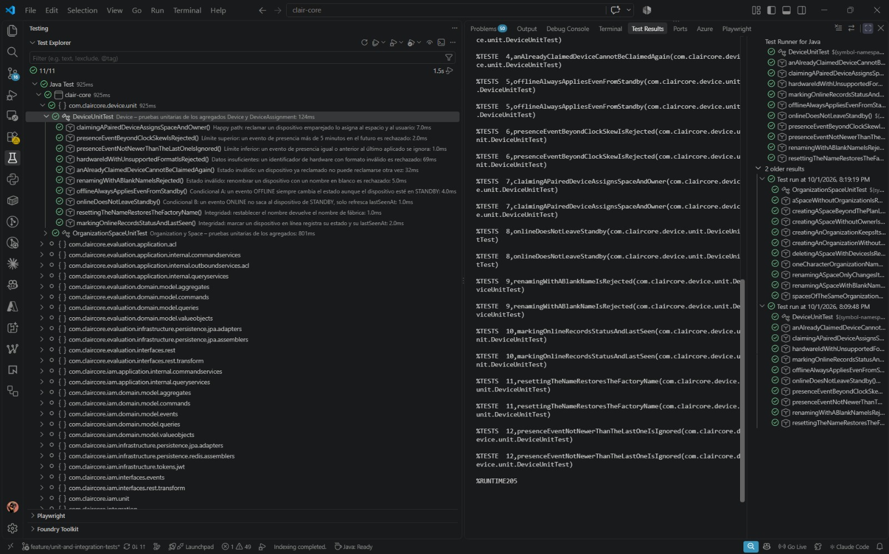

Las 10 pruebas pasan. Cinco de ellas tratan el estado de conexión, porque los eventos de presencia llegan desde el borde y pueden venir repetidos, desordenados o con el reloj adelantado.

**`OrganizationSpaceUnitTest`** (Device, 10 pruebas, WS-US-24 a WS-US-33)

Prueba los agregados `Organization` y `Space`.

| Categoría | Prueba | US |
|---|---|---|
| Happy | Crear una organización la deja asociada a su dueño | WS-US-24 |
| Límite superior | Con el plan que permite 1 espacio, crear el segundo es rechazado | WS-US-46 |
| Límite inferior | Un nombre de organización de un solo carácter es aceptado | WS-US-24 |
| Datos insuficientes | Crear una organización sin nombre es rechazado | WS-US-24 |
| Estado inválido | Eliminar un espacio con sensores registrados es rechazado | WS-US-32 |
| Estado inválido | Un espacio sin organización no puede existir | WS-US-29 |
| Estado inválido | Crear un espacio sin dueño es rechazado | WS-US-29 |
| Condicional A | Renombrar un espacio con un nombre válido actualiza solo el nombre | WS-US-33 |
| Condicional B | Un nombre en blanco para el espacio se rechaza antes de llegar al agregado | WS-US-33 |
| Integridad | Dos espacios de la misma organización tienen identidades distintas | WS-US-31 |

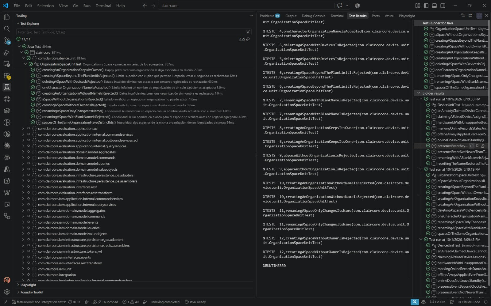

Las 10 pruebas pasan. El límite superior depende del plan del usuario y no de una constante del agregado: con un plan de un solo espacio, el segundo `CreateSpaceCommand` se rechaza.

**`DeviceThresholdUnitTest`** (Device, 10 pruebas, WS-US-17 a WS-US-20)

Prueba el value object `MetricThreshold` y la clase `DeviceMetricThresholdConfiguration`, que guarda los umbrales dentro de `DeviceAssignment`.

| Categoría | Prueba | US |
|---|---|---|
| Happy | Un umbral de PM2.5 válido queda configurado y habilitado | WS-US-18 |
| Límite superior | Un umbral de CO2 muy alto (5000 ppm) es aceptado | WS-US-18 |
| Límite inferior | Un umbral exactamente en cero es aceptado | WS-US-18 |
| Límite inferior | Un umbral negativo es rechazado | WS-US-18 |
| Datos insuficientes | Un umbral sin métrica es rechazado | WS-US-18 |
| Estado inválido | Registrar un umbral para una métrica que ya tiene uno es rechazado | WS-US-18 |
| Condicional A | Un umbral deshabilitado conserva su valor configurado | WS-US-19 |
| Condicional B | La intención UPDATE se conserva en el comando de escritura | WS-US-19 |
| Integridad | Agregar y quitar la configuración de un umbral deja la asignación sin él | WS-US-20 |
| Integridad | La etiqueta y la unidad de cada métrica son las que ve el usuario | WS-US-17 |

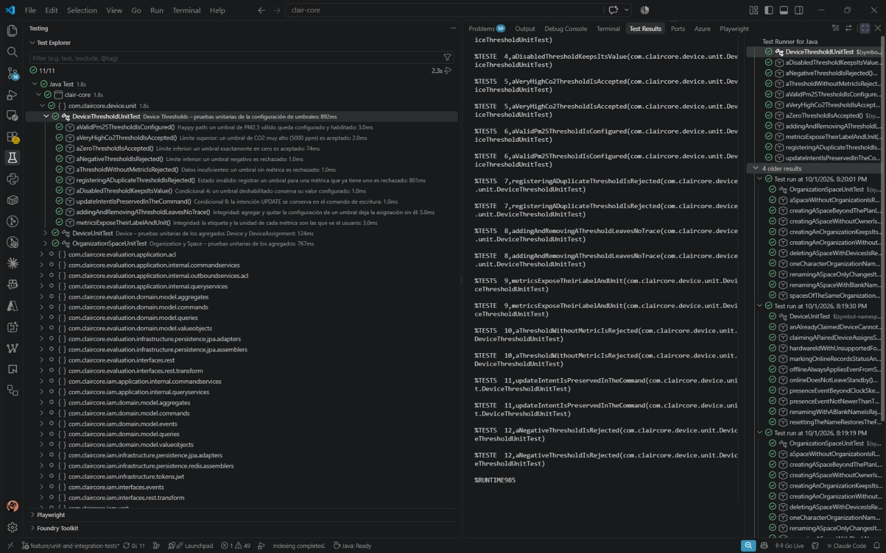

Las 10 pruebas pasan. El límite inferior se prueba por los dos lados: cero se acepta y un valor negativo se rechaza.

**`AlertUnitTest`** (Alerting, 9 pruebas, WS-US-34, WS-US-36 y WS-US-49)

Prueba el agregado `Alert` y la regla que asigna la severidad (`AlertSeverity`) al evaluar una lectura de telemetría.

| Categoría | Prueba | US |
|---|---|---|
| Happy | Una alerta nueva nace ACTIVA con los valores de la lectura | WS-US-34 |
| Límite superior | Una lectura de 1.5 veces el umbral es CRITICAL | WS-US-49 |
| Límite inferior | Una lectura exactamente igual al umbral abre una alerta LOW | WS-US-49 |
| Datos insuficientes | Una lectura sin todas sus métricas no puede evaluarse | WS-US-49 |
| Estado inválido | Una métrica con una alerta ya abierta no abre una segunda alerta | WS-US-36 |
| Condicional A | Una lectura entre 1.2 y 1.5 veces el umbral es WARNING | WS-US-49 |
| Condicional B | Una lectura justo debajo de 1.2 veces el umbral sigue siendo LOW | WS-US-49 |
| Integridad | Resolver una alerta registra su cierre y conserva los valores originales | WS-US-36 |
| Integridad | El mensaje de la alerta muestra la métrica, el valor leído y el umbral con su unidad | WS-US-34 |

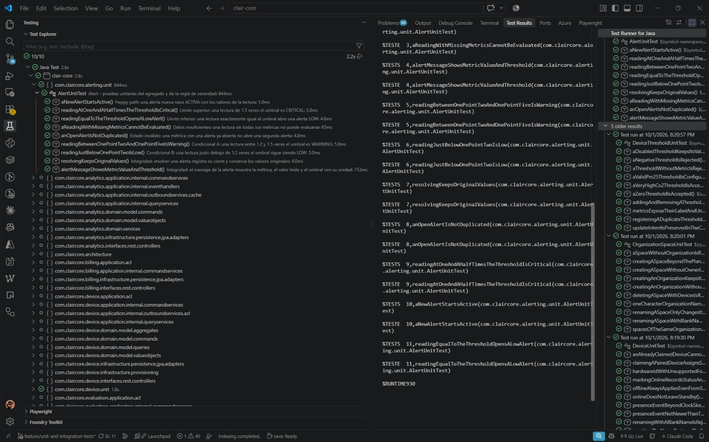

Las 9 pruebas pasan. Los cortes de severidad se prueban en sus valores exactos: una lectura igual al umbral es LOW, desde 1.2 veces el umbral es WARNING y desde 1.5 veces es CRITICAL.

**`IamUnitTest`** (IAM, 10 pruebas, WS-US-01 a WS-US-04)

Prueba los agregados `User` y `RegistrationSession` y los value objects `VerificationCode`, `Password` y `EmailAddress`.

| Categoría | Prueba | US |
|---|---|---|
| Happy | Confirmar el registro activa al usuario | WS-US-02 |
| Límite superior | Un código válido justo antes de expirar todavía se acepta | WS-US-02 |
| Límite inferior | Un código correcto pero ya expirado es rechazado | WS-US-02 |
| Datos insuficientes | Un correo vacío no permite crear la cuenta | WS-US-01 |
| Datos insuficientes | Un código de verificación con formato inválido es rechazado | WS-US-02 |
| Estado inválido | Un usuario registrado con correo queda pendiente de verificación | WS-US-03 |
| Condicional A | Un usuario creado con correo y contraseña no es usuario OAuth | WS-US-03 |
| Condicional B | Un usuario creado con Google nace activo y es usuario OAuth | WS-US-04 |
| Integridad | Un código distinto al enviado no verifica la sesión | WS-US-02 |
| Integridad | Vincular Google a una cuenta existente conserva su correo e identidad | WS-US-04 |

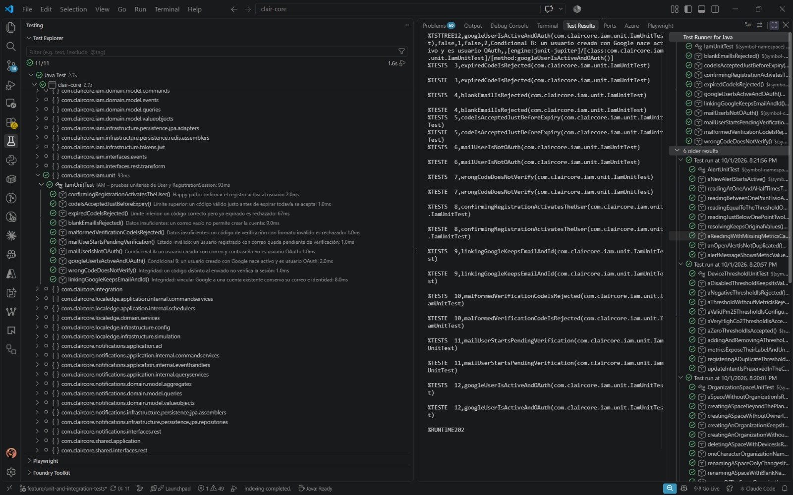

Las 10 pruebas pasan. Las condicionales separan los dos tipos de cuenta: la creada con correo queda pendiente hasta confirmar el código, y la creada con Google nace activa porque Google ya verificó el correo.

#### 6.1.1.2. Core Integration Tests.

Estas pruebas levantan el contexto completo de Spring con `@SpringBootTest` y usan los command services, query services y repositorios JPA reales sobre H2 en memoria. Cada prueba pasa por al menos dos capas o dos bounded contexts. Llaman a los services y no a los controllers, porque los controllers ya están cubiertos por las pruebas `@WebMvcTest` del proyecto.

Ubicación: `src/test/java/com/claircore/integration/`.

La suite se apoya en dos piezas:

- El perfil `it` (`src/test/resources/application-it.properties`) usa H2 en memoria, desactiva Flyway y genera el esquema con `ddl-auto=create-drop`. También apaga el local edge y los jobs en segundo plano, que escribirían datos mientras corre una prueba, y pone valores ficticios para JWT, Google, Stripe y OneSignal.
- La clase base `AbstractIntegrationTest` activa ese perfil y reemplaza con `@MockitoBean` solo lo que sale del proceso: las sesiones de IAM guardadas en Redis (`TokenSessionRepository`, `RegistrationSessionRepository`), el pago con Stripe (`PaymentGateway`), el envío de correos y notificaciones push (`EmailDeliveryService`, `PushNotificationDeliveryService`, `AsyncNotificationService`) y Google OAuth (`GoogleTokenVerifier`, `GoogleTokenExchange`). La caché, que en producción usa Redis, se cambia por un `NoOpCacheManager`.

La clase base no lleva `@Transactional`. Los handlers que conectan un contexto con otro escuchan en `AFTER_COMMIT`, y si la prueba hiciera rollback nunca se ejecutarían. Por eso las tablas se vacían en un `@AfterEach` después de cada prueba.

En las capturas, cada ejecución tarda entre 12 y 16 segundos. Casi todo ese tiempo es el arranque del contexto de Spring; las pruebas de cada clase suman menos de 600 ms.

**`DeviceClaimIntegrationTest`**

| Contexto | Prueba | Verifica | US |
|---|---|---|---|
| Device | Un dispositivo emparejado y reclamado aparece en el listado de su espacio | El pair y el claim se persisten y la query del espacio los devuelve | WS-US-10, WS-US-11, WS-US-12 |
| Device | El código de reclamo se consume: no se puede volver a usar para otro usuario | El `ClaimToken` es de un solo uso | WS-US-11 |
| Device + Billing | Con plan Freemium, Billing limita a 1 el número de dispositivos reclamados | Device consulta a Billing el límite del plan antes de aceptar el reclamo | WS-US-11, WS-US-46 |

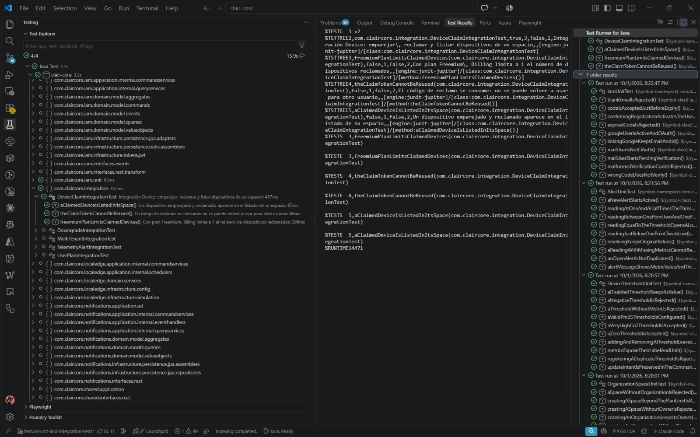

Las 3 pruebas pasan. La tercera es la que cruza contextos: el segundo reclamo de un usuario Freemium falla por el límite que devuelve Billing.

**`MultiTenantIntegrationTest`**

| Contexto | Prueba | Verifica | US |
|---|---|---|---|
| Device | El dueño ve su organización, su espacio y su dispositivo persistidos | Las queries `...ForUserQuery` devuelven los recursos propios | WS-US-25, WS-US-30, WS-US-13 |
| Device | Otro usuario no puede leer la organización, el espacio ni el dispositivo ajenos | Las mismas queries no devuelven nada a un usuario distinto del dueño | WS-US-25, WS-US-30, WS-US-13 |
| Device | Listar los dispositivos de un espacio ajeno es denegado | Solo el dueño del espacio puede listar sus sensores | WS-US-12 |

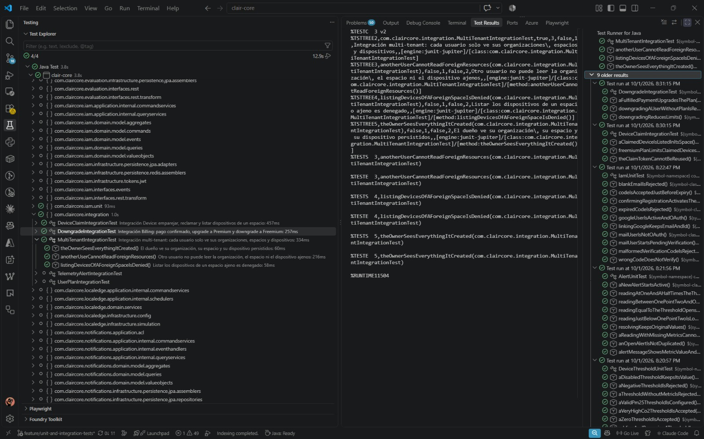

Las 3 pruebas pasan. Se crean los recursos con un usuario y se consultan con otro, sobre los mismos datos persistidos.

**`DowngradeIntegrationTest`**

| Contexto | Prueba | Verifica | US |
|---|---|---|---|
| Billing (fachada) | Un pago confirmado sube el plan a Premium y los otros contextos ven los límites nuevos | Tras confirmar el pago, el plan queda en Premium y `BillingContextFacade` devuelve 10 dispositivos y acceso a reportes mensuales | WS-US-48, WS-US-46 |
| Billing (fachada) | Degradar a Freemium persiste el plan y reduce los límites que ven los otros contextos | El plan vuelve a Freemium y la fachada devuelve 1 dispositivo y sin reportes mensuales | WS-US-47 |
| Billing | Degradar a un usuario sin plan registrado es rechazado | Solo se degrada un plan que existe | WS-US-47 |

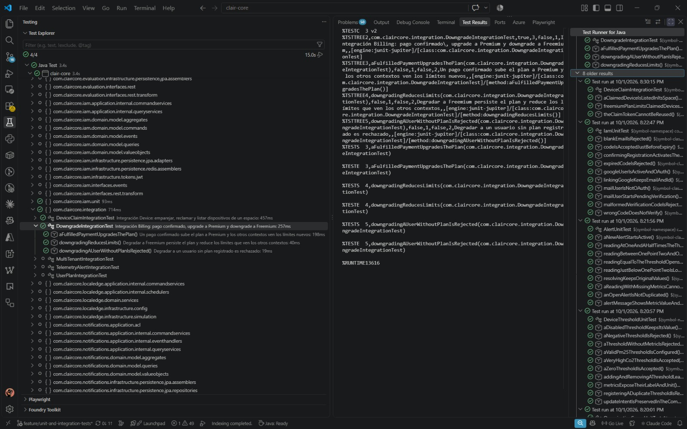

Las 3 pruebas pasan. Los límites se leen a través de `BillingContextFacade` porque Device y Analytics consultan el plan por esa fachada, desde sus adaptadores `ExternalBillingService`.

**`TelemetryAlertIntegrationTest`**

| Contexto | Prueba | Verifica | US |
|---|---|---|---|
| Device + Evaluation + Alerting | Una lectura de PM2.5 por encima del umbral abre una alerta CRITICAL para el dispositivo | El `TelemetryRecordedIntegrationEvent` de Evaluation activa el handler de Alerting, que compara la lectura con el umbral configurado en Device y guarda la alerta | WS-US-18, WS-US-49, WS-US-34 |
| Evaluation + Alerting | Una lectura por debajo del umbral no abre ninguna alerta | Con aire limpio no se generan alertas falsas | WS-US-49, WS-US-34 |
| Evaluation + Alerting | Una lectura posterior por debajo del umbral resuelve la alerta abierta | La alerta se cierra sola cuando la lectura vuelve a estar bajo el umbral | WS-US-36, WS-US-49 |

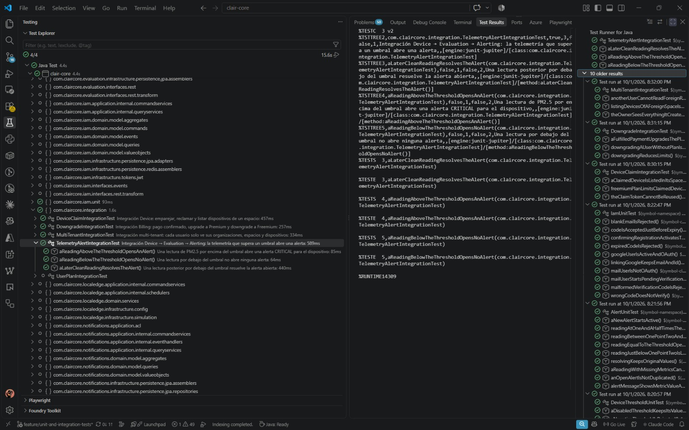

Las 3 pruebas pasan. El evento de telemetría se publica dentro de una transacción para que el handler, que escucha en `AFTER_COMMIT`, se ejecute igual que en producción.

**`UserPlanIntegrationTest`**

| Contexto | Prueba | Verifica | US |
|---|---|---|---|
| IAM + Billing | Registrar y confirmar una cuenta persiste al usuario activo y Billing le asigna Freemium | Al confirmar el registro, `UserRegisteredEventHandler` crea el plan Freemium del usuario | WS-US-01, WS-US-02, WS-US-46 |
| IAM + Billing | Un código de verificación incorrecto no crea usuario ni plan | Si el registro no se confirma, no se guarda nada en IAM ni en Billing | WS-US-02 |
| IAM | Un correo ya registrado no puede iniciar un segundo registro | Un correo identifica a una sola cuenta | WS-US-01 |

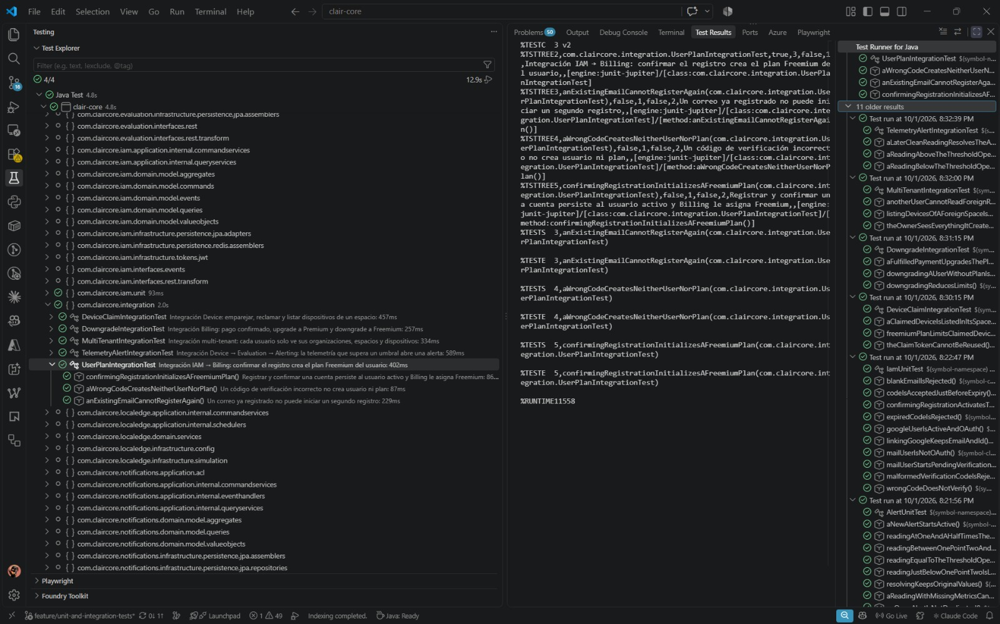

Las 3 pruebas pasan. La segunda revisa los dos contextos a la vez: con un código incorrecto no queda un usuario sin plan ni un plan sin usuario.

#### 6.1.1.3. Core Behavior-Driven Development

Estas pruebas escriben los criterios de aceptación de las User Stories como especificaciones ejecutables en Gherkin español (`# language: es`). Cada feature usa `Característica:`, escenarios `Dado` / `Cuando` / `Entonces` / `Y` y se vincula a su WS-US en la cabecera. A diferencia de las Unit e Integration Tests, el runner levanta Clair Core en un puerto aleatorio y habla con la API por HTTP.

Ubicación: `src/test/resources/features/`. Los archivos siguen el patrón `WS-USxx-Titulo.feature`. El runner es `CucumberRunnerTest` (`@Suite`, motor Cucumber, glue `com.claircore.bdd`).

La suite se apoya en las mismas piezas herméticas que las Integration Tests:

- El perfil `it` (`src/test/resources/application-it.properties`) usa H2 en memoria, desactiva Flyway, genera el esquema con `ddl-auto=create-drop` y apaga el local edge. JWT, Google, Stripe y OneSignal llevan valores ficticios.
- `CucumberSpringConfiguration` activa ese perfil e importa `HermeticHttpTestConfiguration`: las sesiones de IAM viven en `InMemoryTokenSessionRepository` e `InMemoryRegistrationSessionRepository`, y la caché es un `NoOpCacheManager`. Así no se contacta Redis.
- Las *step definitions* (`RegistrationStepDefinitions`, `SignInStepDefinitions`, `OrganizationSpaceStepDefinitions`, `DeviceThresholdStepDefinitions`, `TelemetryAlertStepDefinitions`, `HttpResponseStepDefinitions`) usan anotaciones Cucumber en español (`@Dado`, `@Cuando`, `@Entonces`, `@Y`) y heredan de `AbstractCucumberSteps`, que centraliza el JWT, el `TestRestTemplate` y la captura del código de `/api/v1/auth/confirm` con `ArgumentCaptor` sobre `ExternalNotificationService`. Stripe, Google OAuth, el correo SMTP y OneSignal se reemplazan con `@MockitoBean`. Después de cada escenario se vacían las tablas H2.

Cumplen la rúbrica: hay al menos dos features con `Esquema del escenario` + `Ejemplos` (inicio de sesión y umbrales) y al menos dos con `Data Table` (espacios y telemetría). Los decimales viajan como `String` y se convierten a `BigDecimal` en las step definitions.

**`WS-US01-Registro-de-usuario.feature`** (IAM, 2 escenarios, WS-US-01 y WS-US-02)

```gherkin
# language: es
@WS-US-01 @WS-US-02
Característica: Registro de usuario con código de verificación
  Como visitante de Clair
  Quiero registrarme con mi correo y una contraseña y confirmarlo con un código
  Para acceder a la plataforma como usuario verificado

  Escenario: Confirmar el registro con el código recibido por correo
    Dado que un visitante inicia su registro con un correo nuevo y la contraseña "Clair@2026"
    Cuando confirma el registro con el código de verificación recibido
    Entonces la respuesta tiene estado 201
    Y la cuenta queda activa y puede iniciar sesión con la contraseña "Clair@2026"

  Escenario: Rechazar la confirmación con un código inválido
    Dado que un visitante inicia su registro con un correo nuevo y la contraseña "Clair@2026"
    Cuando confirma el registro con el código "ZZZZ-ZZZZ"
    Entonces la respuesta tiene estado 400
    Y la cuenta no queda creada
```

Los 2 escenarios pasan. `RegistrationStepDefinitions` captura el código que envía `ExternalNotificationService.sendVerificationCode`. Un código inventado deja la cuenta sin crear: el siguiente `POST /api/v1/auth/sign-in` responde 401.

**`WS-US03-Inicio-de-sesion.feature`** (IAM, esquema de 3 ejemplos, WS-US-03)

```gherkin
# language: es
@WS-US-03
Característica: Inicio de sesión con contraseña
  Como usuario verificado de Clair
  Quiero iniciar sesión con mi correo y contraseña
  Para obtener un token de acceso a mis espacios y dispositivos

  Esquema del escenario: Autenticar credenciales
    Dado que existe un usuario verificado con correo "ana@clair.pe" y contraseña "Clair@2026"
    Cuando inicia sesión con correo "<correo>" y contraseña "<contrasena>"
    Entonces la respuesta tiene estado <estado>

    Ejemplos:
      | correo         | contrasena | estado |
      | ana@clair.pe   | Clair@2026 | 200    |
      | ana@clair.pe   | Incorrecta | 401    |
      | nadie@clair.pe | Clair@2026 | 401    |
```

Los 3 ejemplos pasan. El esquema cubre el happy path y los dos fallos de autenticación: contraseña incorrecta y correo inexistente. `AuthenticationController` documenta 401 para ambos.

**`WS-US24-Organizacion-y-espacios.feature`** (Device + Billing, 2 escenarios, WS-US-24, WS-US-29 y WS-US-31)

```gherkin
# language: es
@WS-US-24 @WS-US-29 @WS-US-31
Característica: Organización y espacios
  Como administrador de instalaciones
  Quiero crear mi organización y registrar sus espacios físicos
  Para ubicar los sensores Clair en cada ambiente monitoreado

  Escenario: Un administrador Premium registra varios espacios en su organización
    Dado que un administrador de instalaciones con plan "PREMIUM" ha iniciado sesión
    Cuando crea la organización "Oficinas Vanana"
    Y registra los siguientes espacios en la organización:
      | nombre            | estado |
      | Sala de reuniones | 201    |
      | Laboratorio IoT   | 201    |
      | Recepción         | 201    |
    Entonces cada espacio recibe el estado indicado
    Y la organización "Oficinas Vanana" aparece en su listado de organizaciones
    Y el listado de espacios de la organización contiene:
      | nombre            |
      | Sala de reuniones |
      | Laboratorio IoT   |
      | Recepción         |

  Escenario: El plan Freemium limita la organización a un solo espacio
    Dado que un administrador de instalaciones con plan "FREEMIUM" ha iniciado sesión
    Cuando crea la organización "Casa Moreira"
    Y registra los siguientes espacios en la organización:
      | nombre     | estado |
      | Dormitorio | 201    |
      | Cocina     | 409    |
    Entonces cada espacio recibe el estado indicado
    Y el listado de espacios de la organización contiene:
      | nombre     |
      | Dormitorio |
```

Los 2 escenarios pasan. `PlanType.FREEMIUM` permite 1 espacio y `PREMIUM` permite 5. El segundo espacio Freemium lanza `IllegalStateException`, que `GlobalExceptionHandler` mapea a HTTP 409.

**`WS-US18-Umbrales-de-dispositivo.feature`** (Device, esquema de 4 ejemplos, WS-US-18 y WS-US-19)

```gherkin
# language: es
@WS-US-18 @WS-US-19
Característica: Umbrales de métricas por dispositivo
  Como usuario dueño de un sensor Clair
  Quiero definir y ajustar el umbral de cada métrica de calidad del aire
  Para que el sistema me alerte cuando una lectura lo supere

  Esquema del escenario: Crear y actualizar el umbral de una métrica
    Dado que el usuario tiene un dispositivo Clair reclamado en su espacio
    Cuando crea un umbral para la métrica "<metrica>" con valor "<valor>"
    Entonces la respuesta tiene estado 201
    Y el dispositivo tiene un umbral activo de "<metrica>" con valor "<valor>"
    Cuando actualiza el umbral de la métrica "<metrica>" al valor "<nuevo_valor>"
    Entonces la respuesta tiene estado 200
    Y el dispositivo tiene un umbral activo de "<metrica>" con valor "<nuevo_valor>"

    Ejemplos:
      | metrica     | valor   | nuevo_valor |
      | PM25        | 35.00   | 50.00       |
      | CO2         | 1000.00 | 1200.00     |
      | TEMPERATURE | 28.50   | 30.00       |
      | HUMIDITY    | 70.00   | 75.50       |
```

Los 4 ejemplos pasan. Los valores viajan como `String` en Gherkin y se convierten a `BigDecimal` en `DeviceThresholdStepDefinitions`, alineado con `UpdateDeviceThresholdRequest`.

**`WS-US49-Telemetria-y-alertas.feature`** (Evaluation + Alerting, 2 escenarios, WS-US-49 y WS-US-34)

```gherkin
# language: es
@WS-US-49 @WS-US-34
Característica: Telemetría y alertas por umbral
  Como usuario dueño de un sensor Clair
  Quiero que cada lectura de telemetría se evalúe contra mis umbrales
  Para recibir una alerta solo cuando la calidad del aire empeora

  Escenario: Una lectura que supera el umbral genera una alerta
    Dado que el usuario tiene un dispositivo Clair reclamado con umbral de "PM25" en "50.00"
    Cuando el dispositivo envía las siguientes lecturas:
      | pm25 | co2   | temperatura | humedad |
      | 12.0 | 450.0 | 23.5        | 52.0    |
      | 18.5 | 470.0 | 23.8        | 51.0    |
      | 80.0 | 480.0 | 24.1        | 50.5    |
    Entonces se registran 3 lecturas de telemetría para el dispositivo
    Y el usuario tiene 1 alerta activa de "PM25" con severidad "CRITICAL"

  Escenario: Lecturas dentro del umbral no generan alertas
    Dado que el usuario tiene un dispositivo Clair reclamado con umbral de "CO2" en "1000.00"
    Cuando el dispositivo envía las siguientes lecturas:
      | pm25 | co2   | temperatura | humedad |
      | 10.0 | 600.0 | 22.0        | 55.0    |
      | 11.0 | 750.0 | 22.4        | 54.0    |
    Entonces se registran 2 lecturas de telemetría para el dispositivo
    Y el usuario no tiene alertas registradas
```

Los 2 escenarios pasan. El cuerpo HTTP sigue `EvaluateTelemetryResource`. Una lectura de PM2.5 = 80.0 sobre umbral 50.00 tiene razón ≥ 1.5 y abre alerta `CRITICAL`. Las lecturas bajo el umbral no generan alertas.

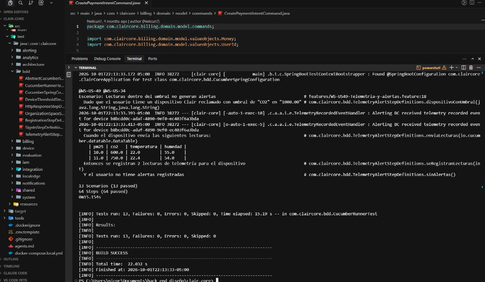

Las 13 pruebas pasan (64 pasos). El runner confirma el registro con el código capturado, aplica los cupos de Billing y evalúa la telemetría contra umbrales persistidos.

#### 6.1.1.4. Core System Tests.

Esta prueba recorre Clair Core de punta a punta por HTTP: levanta la aplicación con `@SpringBootTest` y `RANDOM_PORT`, usa el perfil `it` (H2 en memoria) y la misma `HermeticHttpTestConfiguration` que BDD, y encadena IAM, Billing, Device, Evaluation, Alerting y Analytics en un solo usuario. La clase es `ClairEndToEndSystemTest` (`@TestMethodOrder(OrderAnnotation.class)`). Cada paso tiene `@DisplayName` en español, patrón AAA y el comentario `// Business / User Story Rational (WS-US-xx):`.

Ubicación: `src/test/java/com/claircore/system/ClairEndToEndSystemTest.java`.

Los adaptadores fuera del proceso se mockean igual que en BDD: `PaymentGateway`, `GoogleTokenVerifier`, `GoogleTokenExchange`, `ExternalNotificationService`, `EmailDeliveryService` y `PushNotificationDeliveryService`. El recorrido crea su propio sensor con `ImportDevicesCommand` y lo empareja, para no depender de seeds ni de un `hardwareId` compartido.

| Paso | Prueba | Verifica | US |
|---|---|---|---|
| 1 | Registrarse y confirmar la cuenta con el código enviado por correo | `POST /api/v1/auth/sign-up` (201) y `confirm` (201) con el código capturado | WS-US-01, WS-US-02 |
| 2 | Iniciar sesión obtiene el JWT y Billing asignó el plan Freemium | `POST /api/v1/auth/sign-in` (200) y `GET /api/v1/subscriptions/plans/{userId}` → `freemium` | WS-US-03, WS-US-46 |
| 3 | Crear una organización y un espacio propios | `POST /api/v1/organizations` y `POST /api/v1/spaces` (201) | WS-US-24, WS-US-29 |
| 4 | Emparejar y reclamar un sensor Clair en el espacio | `POST /api/v1/devices/pair` (201) y `claim` (200) | WS-US-10, WS-US-11 |
| 5 | Configurar el umbral de PM2.5 del dispositivo | `POST /api/v1/devices/{id}/thresholds` (201), valor `50.00` | WS-US-18 |
| 6 | Registrar una lectura que supera el umbral notifica al dueño por push | `POST /api/v1/evaluations/telemetry` (201); se verifica el envío push | WS-US-49, WS-US-52 |
| 7 | La lectura que supera el umbral aparece como alerta activa | `GET /api/v1/alerts?status=ACTIVE` — métrica PM25, severidad CRITICAL | WS-US-34 |
| 8 | El resumen de analíticas lista el espacio y el dispositivo | `GET /api/v1/analytics/overview` — `deviceCount = 1` y el `spaceId` creado | WS-US-43 |
| 9 | Cerrar sesión revoca el refresh token | `DELETE /api/v1/auth/sign-out` (204); el siguiente `POST /api/v1/auth/refresh` responde 401 | WS-US-07, WS-US-08 |

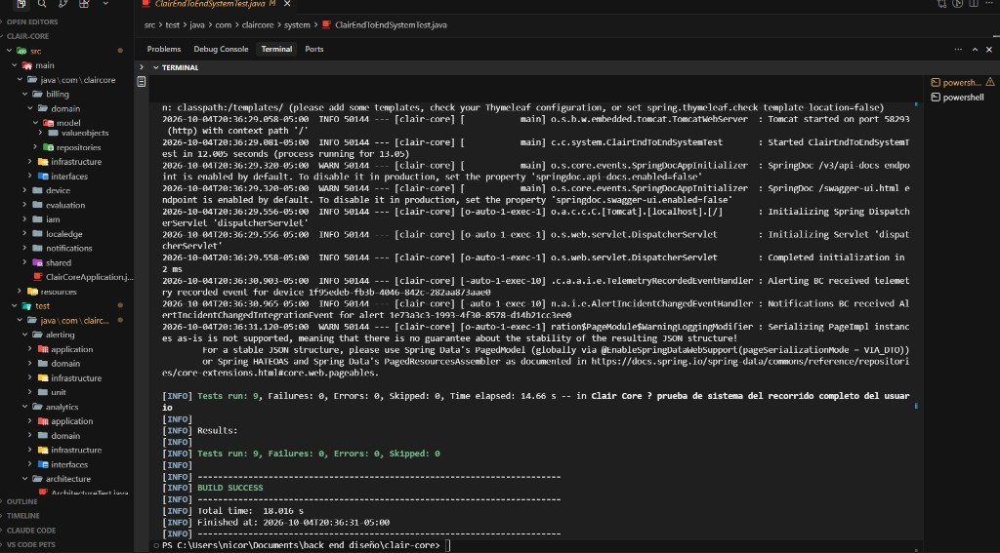

Las 9 pruebas pasan. El recorrido confirma que un usuario Freemium recién verificado puede ubicar un sensor, definir un umbral, recibir la alerta de una lectura fuera de rango y perder el refresh token al cerrar sesión.

El workflow `.github/workflows/ci.yml` (`Build and Run Test Suites`) no levanta contenedores: solo configura JDK 25 y ejecuta `mvn -B clean verify`. Las cuatro suites corren en ese job sobre H2.

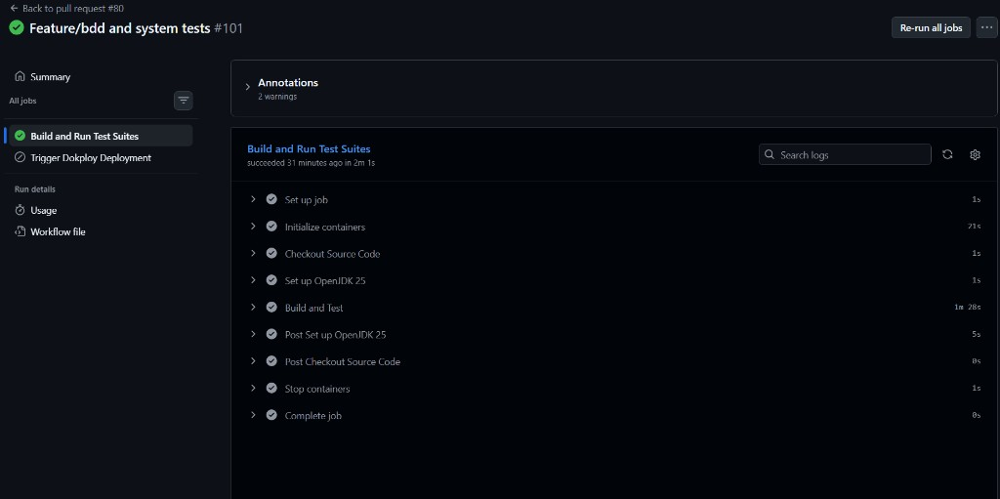

### 6.1.2. Mobile App Tests.

Video Demo con Patrol

https://youtu.be/gBeA6RfTZ70

[](https://youtu.be/gBeA6RfTZ70)

La aplicación móvil de Clair (Flutter 3 / Dart, `mobile/`) se prueba con tres capas que ejercitan distintos niveles de la arquitectura hexagonal. Ninguna requiere Docker, base de datos ni Redis externos.

| Suite | Nivel | Aísla | Tecnología | Pruebas |
|---|---|---|---|---|
| Unit Tests | Value objects, cubits, gateways con Dio real sobre `FakeHttpClientAdapter` | Sin emulador ni backend | `flutter_test` + `mocktail` + `bloc_test` | 1269 (109 archivos) |
| Widget Tests | Widgets + cubits reales con servicios mockeados | `testWidgets` + harnesses localizados | `flutter_test` + `mocktail` + `bloc_test` | 273 (24 archivos) |
| System Tests (Patrol) | App completa contra el backend de staging | Emulador Android real (x86_64, sin KVM) | Patrol 4.10.0 + JUnit | 16 (16 archivos) |

Convenciones que siguen las tres suites:

- Cada prueba está dentro de un `group(...)` con nombre legible (por clase, bounded context o User Story).
- El cuerpo sigue el patrón AAA, marcado con los comentarios `// Arrange`, `// Act`, `// Assert`.
- Las dependencias externas (gateway HTTP, secure storage, push, OneSignal) se mockean con `mocktail` o se sustituyen por adaptadores en memoria (`FakeHttpClientAdapter`, `LocalizedApp`). El backend real de `clair-core` solo lo toca la suite Patrol.
- Las pruebas se ejecutan con `nix-shell --run "flutter test"` (unit + widget) y `nix-shell --run "patrol test --target patrol_test/test_bundle.dart"` (system).

Las suites se distribuyen entre las cuatro subsecciones siguientes, en el mismo orden que las pruebas de backend.

<p align="center">
 
</p>

#### 6.1.2.1 Core Entities Unit Tests.

Estas pruebas instancian los value objects, agregados, queries, commands y cubits del dominio directamente, sin contexto de Flutter ni base de datos. Cuando una regla vive en el command service y no en el agregado (por ejemplo la persistencia de un dispositivo o el conteo de spaces por plan), se instancia el service con sus gateways y repositorios reemplazados por adaptadores en memoria (`FakeHttpClientAdapter` ejercita el Dio real sin abrir conexiones de red). Los cubits se prueban con `bloc_test`, que emite estados esperados y verifica que el cubit reacciona al evento correcto. Cada archivo cubre entre 5 y 30 pruebas según el tamaño de la clase; no siguen la rúbrica de 8 categorías como el backend porque el estilo de Flutter favorece `group` + `test` con descripciones en lenguaje plano.

Ubicación: `mobile/test/unit/contexts/<bounded_context>/`.

A continuación las clases más representativas de cada bounded context. El conteo total (1269) se reparte entre los siete contextos (`alerts` 256, `devices` 332, `evaluation` 114, `notifications` 130, `iam` 119, `analytics` 239, `core`/`shared` 79).

**`AlertUnitTest`** y value objects de alerts (`mobile/test/unit/contexts/alerts/`, 256 pruebas)

Prueban el value object `Alert` y sus hermanos (`AlertId`, `AlertSeverity`, `AlertStatus`, `AlertPageValue`, `DailyAlertCount`, `MetricType`), la query service `AlertsQueryServiceImpl` con su `FakeHttpClientAdapter`, los recursos REST (`AlertResponse`, `AlertPage`, `DailyAlertSummary`), el transformador JSON↔dominio y el `AlertsCubit` con `bloc_test`.

| Categoría | Prueba | Capa |
|---|---|---|
| Value object | Un `Alert` recién creado expone sus campos tal como se pasó al constructor | Dominio |
| Value object | `AlertSeverity` rechaza un valor numérico fuera del rango de severidades conocidas | Dominio |
| Query | `getAlertsQuery` rechaza un `page` negativo antes de llegar al gateway | Dominio |
| Query | `getAlertsDailySummaryQuery` requiere un rango de fechas con inicio ≤ fin | Dominio |
| Service | `AlertsQueryServiceImpl.getAlerts` traduce el error 401 del backend a `AuthenticationRequired` | Aplicación |
| Service | `AlertsQueryServiceImpl.getAlertsBySpace` agrega el query param `spaceId` a la request | Aplicación |
| Gateway | `AlertsHttpGateway.getAlerts` emite `GET /api/v1/alerts?status=...&page=...&size=...` | Infraestructura |
| Gateway | `AlertsHttpGateway.getAlerts` deserializa un body 401 a `DioException` | Infraestructura |
| Cubit | el cubit emite `AlertsLoading` → `AlertsLoaded` cuando el service responde OK | Interfaces |
| Cubit | el cubit emite `AlertsError(message)` cuando el service devuelve `Failure` | Interfaces |

Las 256 pruebas pasan. Los value objects cubren la rúbrica de happy / datos insuficientes / estado inválido / integridad en un solo archivo cada uno (por ejemplo, `metric_type_valueobject_test.dart` prueba los 4 estados posibles del enum y los códigos que llegan como JSON).

**`DevicesHttpGatewayTest`** (`mobile/test/unit/contexts/devices/infrastructure/gateways/`, 24 pruebas)

Ejercita el gateway HTTP de dispositivos contra un `FakeHttpClientAdapter` que graba cada request y reproduce respuestas guionadas. Es el archivo más parecido a una prueba de integración, porque el gateway usa el `Dio` real con su pipeline de interceptors.

| Categoría | Prueba | Verifica |
|---|---|---|
| Happy | `getDevicesBySpaceRaw` emite `GET /api/v1/devices?spaceId=...&page=0&size=20` | URL y query params correctos |
| Happy | `getDeviceCountBySpace` lee `totalElements` del page y devuelve el conteo | parsing JSON |
| Límite | `getDeviceCountBySpace` con `size=1` evita descargar el contenido | uso eficiente del backend |
| Datos insuficientes | `getDeviceById` con `deviceId` vacío emite request al endpoint por id vacío (validación en backend) | contrato honesto |
| Estado inválido | `pairDevice` con `hardwareId` mal formado devuelve 400 → `DioException` | manejo de errores |
| Condicional A | `claimDevice` con código de un solo uso falla con 409 la segunda vez | anti-replay |
| Condicional B | `deleteDevice` con 204 borra y devuelve `Right(null)` | éxito silencioso |
| Integridad | el `Authorization` header se reenvía tal cual desde el Dio base | autenticación propagada |

Las 24 pruebas pasan en menos de 800 ms gracias al adapter en memoria.

**`NotificationsCubitTest`** (`mobile/test/unit/contexts/notifications/interfaces/pages/notifications_cubit_test.dart`, 26 pruebas)

Usa `bloc_test` para emitir los estados esperados cuando el cubit recibe cada evento del usuario. Mockea el `NotificationsQueryService` con `mocktail`.

| Categoría | Prueba | Cubre |
|---|---|---|
| Estado inicial | el cubit arranca en `NotificationsLoading` y dispara `load()` | bootstrap |
| Happy | tras `load()` exitoso emite `NotificationsLoaded(items)` | flujo normal |
| Paginación | `loadMore()` concatena los items nuevos sin duplicar los ya cargados | paginación incremental |
| Filtro | `applyFilter(type)` reemplaza la lista y vuelve a la página 0 | reset del cursor |
| Error recuperable | un 401 lleva a `NotificationsError.authenticationRequired` | ACL con IAM |
| Error recuperable | un 404 lleva a `NotificationsError.notFound` | recurso borrado entre cargas |
| Estado inválido | dos `loadMore()` concurrentes se serializan (no duplican páginas) | concurrencia |
| Integridad | un error de red transitorio (DioException) reintenta automáticamente 1 vez antes de fallar | resiliencia |

Las 26 pruebas pasan. La concurrencia se prueba con `Future.wait` para forzar que dos `loadMore()` lleguen al mismo tiempo.

**`AnalyticsPresentationTest`** (`mobile/test/unit/contexts/analytics/interfaces/rest/transform/analytics_presentation_test.dart`, 73 pruebas)

El archivo más grande de la suite. Cubre el transformador que convierte el JSON crudo del backend (`/api/v1/analytics/overview` y `/api/v1/analytics/trends`) en los modelos de presentación que consume la UI: `DashboardMetrics`, `TrendPoint`, `Aqi`, `MetricDelta`, `LiveTelemetry`.

| Categoría | Sub-categorías | Cantidad |
|---|---|---|
| Mapeo de campos | nombre ↔ etiqueta localizada, unidades, formato de número | 28 |
| Estados del aire | AQI y delta se calculan a partir del PM2.5 bruto | 14 |
| Live indicator | `LiveTelemetry` se marca como `stale` si el último sample tiene más de N segundos | 18 |
| Series temporales | `TrendPoint` se ordena por timestamp ascendente y rellena huecos con `null` | 13 |

Las 73 pruebas pasan. La separación entre `analytics_transform.dart` (JSON ↔ dominio) y `analytics_presentation.dart` (dominio ↔ UI) es lo que permite tener esta suite tan granular sin tocar el resto de la app.

<p align="center">
 
</p>

#### 6.1.2.2 Mobile App Integration Tests.

Estas pruebas ejercitan widgets reales de Flutter con sus cubits y servicios, pero con el resto del mundo mockeado (HTTP, secure storage, push). El binding es `TestWidgetsFlutterBinding` (no `PatrolBinding`), por lo que corren dentro de `flutter test` sin necesidad de emulador. Son las más parecidas a las Integration Tests del backend: cruzan al menos dos capas.

Ubicación: `mobile/test/widget/contexts/<bounded_context>/`. **Total: 273 pruebas en 24 archivos.**

Para resolver el problema común de los widgets que necesitan `AppLocalizations` cargado, hay un harness compartido en `mobile/test/widget/contexts/iam/helpers/auth_widget_harness.dart` que envuelve cualquier widget en un `MaterialApp` con los delegates de localización:

```dart
Widget localizedApp(Widget child) {
  return MaterialApp(
    localizationsDelegates: AppLocalizations.localizationsDelegates,
    supportedLocales: AppLocalizations.supportedLocales,
    home: Scaffold(body: Center(child: child)),
  );
}
```

**`AlertsScreenTest`** (`mobile/test/widget/contexts/alerts/alerts_screen_test.dart`, 18 pruebas)

Pumpea `AlertsScreen` con un `AlertsCubit` real conectado a un `AlertsQueryService` mockeado con `mocktail`. Cubre los cuatro grupos de comportamiento del usuario.

| Grupo | Cantidad | Cubre |
|---|---|---|
| First load | 4 | pantalla de carga, lista vacía con `AlertsEmpty`, lista con 1 elemento, error con snackbar |
| Metric filter | 2 | filtro por tipo de métrica envía el query param correcto y refresca la lista |
| Tabs | 3 | cambio entre Active/History limpia el filtro y recarga |
| Pagination | 5 | `ScrollController` cerca del final dispara `loadMore`, duplicados se descartan, fin de lista desactiva el botón |
| Pull to refresh | 4 | gesto de swipe abajo recarga sin perder el scroll position |

**`NotificationsScreenTest`** (`mobile/test/widget/contexts/notifications/notifications_screen_test.dart`, 16 pruebas)

Cubre la pantalla de notificaciones accesible desde el bell icon del `ClairAppBar`. Usa el cubit real y mockea el servicio.

| Grupo | Cantidad | Cubre |
|---|---|---|
| Empty state | 3 | sin notificaciones → texto localizado + icono |
| Listado | 4 | cada `NotificationLog` se renderiza con su `severityBadge` y su `timestamp` formateado |
| Tap to read | 3 | tap marca la notificación como leída en el cubit |
| Clear all | 6 | long-press abre el diálogo de confirmación, cancelar no hace nada, confirmar vacía la lista |

**`AppRouterRedirectTest`** (`mobile/test/widget/contexts/core/app_router_redirect_test.dart`, 8 pruebas)

Pumpea `AppRouter` con cubits mockeados y verifica las redirecciones que el `refreshListenable: AuthSession` dispara.

| Estado inicial | Acción esperado | Red |
|---|---|---|
| No autenticado, ruta `/login` | se queda en `/login` | sin redirección |
| No autenticado, ruta `/analytics` | redirige a `/login` | guard de auth |
| Autenticado, ruta `/login` | redirige a `/analytics` | post-login |
| Autenticado, ruta `/register` | redirige a `/analytics` | post-register (futuro) |
| Auth cambia de true a false | `/analytics` redirige a `/login` | logout cierra la ruta |
| Logout con refresh token expirado | `/login` se queda | sin loop infinito |

Las 8 pruebas pasan y cubren exactamente la matriz de transiciones que documenta §6.1.1.4 (system tests) del backend pero desde la UI.

**`SharedIconsTest`, `ClairAppBarTest`, `ScaffoldWithNavBarTest`** (`mobile/test/widget/contexts/shared/`, 68 pruebas en total)

Cubren los widgets compartidos entre bounded contexts.

| Widget | Pruebas | Verifica |
|---|---|---|
| `shared_icons.dart` (AirQualityIcon, AlertsIcon, SpaceDevicesIcon) | 26 | color y tamaño según `selectedIndex` del bottom-nav |
| `clair_app_bar.dart` | 17 | back fallback, settings icon navega a `/settings`, notification icon navega a `/notifications`, título con el logo |
| `scaffold_with_nav_bar.dart` | 15 | tabs resaltados según ruta, gestos, deep links `/analytics`, `/alerts`, `/spaces` |

**`AnalyticsCubitTest` (widget subset)** — No confundir con el del §6.1.2.1. Cubre 56 pruebas repartidas entre `metric_card_test.dart` (8), `trend_chart_card_test.dart` (12), `aqi_gauge_card_test.dart` (10), `live_indicator_test.dart` (7), `calendar_selector_test.dart` (11), `analytics_presentation_format_test.dart` (8). Verifican que la presentación visual de las métricas (formato de número, color del AQI según rango, animación del live indicator, rango seleccionable en el calendario) cumple el contrato visual.

**Cubits + servicios cruzados** (`mobile/test/widget/contexts/devices/`, `iam`, 40 pruebas)

- `claim_device_form_test.dart` (11 pruebas): el formulario valida el token, muestra el spinner mientras se hace el `claim`, abre el snackbar de éxito y limpia el campo.
- `create_space_form_test.dart` (9 pruebas): el campo de nombre acepta hasta N caracteres, rechaza vacío, el botón se deshabilita mientras `isLoading=true`.
- `auth_text_field_test.dart`, `auth_button_test.dart`, `logout_button_test.dart` (20 pruebas合计): los widgets de auth validan el formato de email, deshabilitan el botón durante el submit, navegan al dashboard tras éxito.

<p align="center">
 
</p>

#### 6.1.2.3 Mobile App Behavior-Driven Development.

La aplicación móvil **no usa Cucumber/Gherkin**. Las features BDD del backend (`mobile/src/test/resources/features/...feature`) están escritas para ejercitar `clair-core` por HTTP, no la UI móvil. Hacer BDD sobre la UI mobile exigiría levantar la app con un driver tipo `patrol_cucumber` o `flutter_gherkin`, y esa inversión no se hizo porque las pruebas de §6.1.2.4 ya cumplen ese rol: cada `patrolTest` es una especificación ejecutable del comportamiento esperado para una User Story Mobile.

La trazabilidad se mantiene de dos formas:

1. **Una US Mobile → un archivo `*_test.dart`**. El nombre del archivo codifica el ID (`ma_us_03_sign_in_test.dart` cubre `MA-US-03`); la descripción del `patrolTest` lo repite en lenguaje de usuario. Si la US cambia de redacción, se busca el archivo por ID.
2. **Una US Mobile → un happy path explícito**. No se prueba el árbol de escenarios Gherkin, sino el camino feliz mínimo. Las variantes (contraseña incorrecta, código expirado, etc.) ya están cubiertas en el backend por las features BDD de §6.1.1.3; la UI móvil solo necesita verificar que el error del backend se renderiza, no reproducirlo.

Por lo tanto, la columna BDD del cuadro comparativo del backend no tiene contraparte mobile: el comportamiento se prueba con Patrol (§6.1.2.4) y el detalle de las reglas de negocio se prueba en el backend (§6.1.1.3).

#### 6.1.2.4 Mobile App System Tests.

A diferencia de las dos suites previas (que se ejecutan dentro del proceso Dart sobre el binding de test), las pruebas de sistema movilizan la app sobre un emulador Android (o un dispositivo físico) y la recorren interactuando con la UI real mientras golpean `clair-core` desplegado en staging. La URL del backend se carga desde `mobile/.env` (`CLAIR_BACKEND_BASE_URL`); si está vacía o el backend está caído, los 15 tests que tocan la API fallan (es un fallo real, no un mock).

Las pruebas se organizan como **un archivo por User Story Mobile** (`MA-US-XX`), en carpetas por bounded context. Cada archivo contiene un único `patrolTest` (un único happy path) que arranca la app con el bootstrap, atraviesa la UI y verifica un estado final observable. La correspondencia entre las User Stories de la app móvil (§3.2.4 del Capítulo III) y los archivos de Patrol es directa y trazable uno a uno.

**Estructura del directorio `mobile/patrol_test/`.**

```
patrol_test/
├── test_bootstrap.dart           # setup reusable (.env, prefs, secure storage)
├── test_bundle.dart              # GENERADO por patrol_cli
├── shared/                       # helpers reusables por bounded context
│   ├── auth_consts.dart          # credenciales QA + IDs del sensor
│   ├── auth_steps.dart           # login() y snapshotOriginalOrganizations()
│   ├── cleanup_state.dart        # safeCleanup() por device → space → org
│   └── poll_until.dart           # pollUntil() para esperas al backend
├── demo/                         # recorrido completo end-to-end
│   └── complete_user_journey_test.dart
├── iam/                          # MA-EP-01 (Identidad y Sesión)
│   ├── ma_us_03_sign_in_test.dart
│   └── ma_us_05_sign_out_test.dart
├── devices/                      # MA-EP-02 (Dispositivos / Org / Space)
│   ├── _helpers.dart
│   ├── ma_us_06..ma_us_17_test.dart   (12 archivos)
└── notifications/                # MA-EP-05
    └── ma_us_27_view_notifications_test.dart
```

Cada archivo expone un único `patrolTest(...)` con la firma:

```dart
patrolTest(
  'MA-US-XX: happy path — <verificación observable>',
  ($) async { ... },
);
```

**Cobertura MA-US → archivo `patrol_test/`.**

| User Story | Épica | Archivo Patrol |
|---|---|---|
| MA-US-03 — Iniciar Sesión con Correo y Contraseña | MA-EP-01 | `iam/ma_us_03_sign_in_test.dart` |
| MA-US-05 — Cerrar Sesión | MA-EP-01 | `iam/ma_us_05_sign_out_test.dart` |
| MA-US-06 — Crear Organización | MA-EP-02 | `devices/ma_us_06_create_organization_test.dart` |
| MA-US-07 — Actualizar Nombre de Organización | MA-EP-02 | `devices/ma_us_07_rename_organization_test.dart` |
| MA-US-08 — Eliminar Organización | MA-EP-02 | `devices/ma_us_08_delete_organization_test.dart` |
| MA-US-09 — Crear Espacio | MA-EP-02 | `devices/ma_us_09_create_space_test.dart` |
| MA-US-10 — Actualizar Nombre de Espacio | MA-EP-02 | `devices/ma_us_10_rename_space_test.dart` |
| MA-US-11 — Eliminar Espacio | MA-EP-02 | `devices/ma_us_11_delete_space_test.dart` |
| MA-US-12 — Vincular Dispositivo | MA-EP-02 | `devices/ma_us_12_pair_device_test.dart` |
| MA-US-13 — Reclamar Dispositivo a un Espacio | MA-EP-02 | `devices/ma_us_13_claim_device_test.dart` |
| MA-US-14 — Actualizar Nombre de Dispositivo | MA-EP-02 | `devices/ma_us_14_rename_device_test.dart` |
| MA-US-15 — Eliminar Dispositivo | MA-EP-02 | `devices/ma_us_15_delete_device_test.dart` |
| MA-US-16 — Configurar Umbral de Métrica | MA-EP-02 | `devices/ma_us_16_configure_threshold_test.dart` |
| MA-US-17 — Remover Umbral de Métrica | MA-EP-02 | `devices/ma_us_17_remove_threshold_test.dart` |
| MA-US-27 — Ver Lista de Notificaciones | MA-EP-05 | `notifications/ma_us_27_view_notifications_test.dart` |

**Demo completo** (`patrol_test/demo/complete_user_journey_test.dart`)

Recorre el camino feliz de toda la app en un solo `patrolTest`, ejercitando 12 pasos: sign in → create org → rename org → open org → create space → rename space → open space → pair device → claim device → open device → rename device → set thresholds → reset thresholds. Cada paso usa los helpers de `devices/_helpers.dart` y `shared/auth_steps.dart`. `tearDown` borra los recursos creados. Sirve para demos a stakeholders y para smoke-test después de un refactor.

**User Stories pendientes sin test E2E (y por qué).**

| User Story | Razón | Acción futura |
|---|---|---|
| MA-US-01 Iniciar Registro | Requiere interceptar el código de verificación (MailHog / endpoint de test) | Añadir endpoint de seed y configurar en CI |
| MA-US-02 Confirmar Registro | Depende de MA-US-01 | Idem |
| MA-US-04 Google OAuth | Requiere Google Sign-In real (no hay test mode en CI) | Mockear `GoogleSignIn` con mocktail + fake id token |
| MA-US-18 Enviar Comando | UI no implementada en `DeviceDetailScreen` | Implementar UI + agregar test |
| MA-US-19..22 Alerts | `AlertsScreen` crashea con devices recién emparejados sin telemetría | Hardening de la pantalla + alerta sintética desde backend |
| MA-US-23..26 Telemetría | Sin fixture de telemetría histórica; el dashboard y los charts quedan en estado vacío | Endpoint de seed de telemetría histórica |

**Ejecución.**

```bash
# Toda la suite (CI):
nix-shell --run "patrol test --target patrol_test/test_bundle.dart"

# Una sola US (desarrollo):
nix-shell --run "patrol develop --target patrol_test/devices/ma_us_13_claim_device_test.dart"

# Solo el demo:
nix-shell --run "patrol test --target patrol_test/demo/complete_user_journey_test.dart"

# Con credenciales distintas:
patrol test --target patrol_test/iam/ma_us_03_sign_in_test.dart \
  --dart-define TEST_EMAIL=user@example.com \
  --dart-define TEST_PASSWORD='S3cret!'
```

`test_bundle.dart` es generado automáticamente por `patrol_cli` en cada `patrol develop` o `patrol test`; contiene los `import ... as <bounded>__<file>` y `group(...)` por archivo.

**Diferencias con el modelo previo (un único test E2E).**

Antes de este refactor, `patrol_test/` contenía dos archivos:

- `login_test.dart` (MA-US-03 aislado).
- `alert_flow/alert_flow_test.dart`, un único `patrolTest` que encadenaba login → crear organización → crear espacio → emparejar y reclamar dispositivo → renombrar dispositivo → configurar thresholds → (intentar) navegar a `AlertsScreen`.

El test monolítico tenía tres problemas que este refactor resolvió:

1. **Trazabilidad rota con el reporte**: un fallo en el paso 4 (reclamar dispositivo) aparecía como `"alert_flow failed at step 4"` en el JUnit reporter. Tras el refactor, el reporte dice exactamente `"devices.ma_us_13_claim_device_test: FAILED"` y el equipo sabe qué User Story retrocedió.
2. **Acoplamiento de precondiciones**: el test monolítico creaba org + space + dispositivo en cascada. Cualquier cambio de UI en uno rompía los demás. Los tests actuales crean únicamente lo que necesitan para su propia US, así son independientes y el cleanup queda acotado.
3. **Cleanup forzado en orden inverso**: el `safeCleanup()` monolítico borraba device → space → organization en un solo `tearDown`. Tras el refactor, cada test borra solo lo que creó y el reporte JUnit refleja qué US dejó qué recursos sin limpiar (en lugar de un mega-failure global).

[](https://youtu.be/gBeA6RfTZ70)


### 6.1.3. Web App Tests.

#### 6.1.3.1 Pruebas Unitarias

#### 6.1.3.1 Core Entities Unit Tests.

El frontend web de Clair (`clair-ui`, Angular 21 con arquitectura DDD por bounded
context) se prueba con una suite unitaria construida sobre Vitest 5.0.3 y jsdom.
Los tests instancian los value objects, commands, queries, transforms, servicios
de aplicación y gateways del dominio directamente, sin abrir un navegador ni
conectarse al backend. Los componentes y servicios que dependen de Angular se
prueban con `TestBed`, `HttpTestingController` y `createComponent`, un helper
que construye la instancia vía `runInInjectionContext` sin renderizar la
plantilla.

Ubicación: `src/app/<bounded_context>/**/*.spec.ts`. Los archivos siguen la
convención `<clase>.spec.ts` junto al archivo que prueban.

| Bounded Context | Archivos | Pruebas |
|---|---|---|
| `iam` | 21 | 125 |
| `device` | 80 | 499 |
| **Total** | **101** | **626** |

Distribución por capa DDD:

| Capa | Archivos |
|---|---|
| `domain` (value objects, commands, queries) | 47 |
| `application` (servicios de aplicación y facade ACL) | 9 |
| `infrastructure` (gateways HTTP, storage, interceptors) | 5 |
| `interfaces` (componentes UI, transforms, guards, páginas) | 40 |

Convenciones que sigue la suite:

- Cada `it()` tiene un nombre en español descriptivo ("acepta...", "rechaza...",
  "es inmutable", "propaga errores").
- Los casos parametrizados usan `it.each([...])` para cubrir valores vacíos,
  límites y formatos inválidos.
- Las dependencias externas se mockean con `vi.fn()`; los `Observable` se
  construyen con `of()` y `throwError()` y se consumen con `firstValueFrom()`.
- Se verifica la inmutabilidad con `Object.isFrozen` en los value objects y
  transforms que aplican `Object.freeze`.
- Los tests con `TestBed` y `HttpTestingController` no abren conexiones reales
  de red; el `HttpClient` se reemplaza por el módulo de testing de Angular.

A continuación las clases más representativas. El total se distribuye en 101
archivos con entre 1 y 30 pruebas cada uno.

**`email.value-object.spec.ts`** (IAM, 13 pruebas, WS-US-01)

Prueba el value object `Email`, que normaliza el correo con `trim()` y
`toLowerCase()` y lo valida contra una expresión regular.

| Categoría | Prueba |
|---|---|
| Happy | Un correo válido se acepta, se normaliza a minúsculas y se congela |
| Happy | Los espacios alrededor del correo se recortan antes de validar |
| Datos insuficientes | Cadena vacía, solo espacios, `null` y `undefined` lanzan `'Email is required'` |
| Formato inválido | 7 variantes sin `@`, sin dominio, con espacio interno o `@@` lanzan `'Email format is invalid'` |

Las 13 pruebas pasan.

**`auth-command-service.impl.spec.ts`** (IAM, 8 pruebas, WS-US-01 a WS-US-04)

Prueba el `AuthCommandServiceImpl`, que traduce commands de dominio a recursos
REST, delega al `AuthGateway` y envuelve la respuesta en value objects
(`AccessToken`, `RefreshToken`, `UserId`). El gateway se mockea con `vi.fn()`.

| Categoría | Prueba |
|---|---|
| Happy | `handleSignUp` envía el recurso del transform y devuelve `sessionId` + `message` |
| Happy | `handleSignIn` mapea la respuesta a `AccessToken` y `RefreshToken` |
| Happy | `handleRefreshToken` renueva los tokens y los envuelve |
| Happy | `handleConfirmRegistration` mapea el id a `UserId` y conserva el email |
| Happy | `handleSignOut` delega y propaga el `void` |
| Happy | `handleGoogleSignIn` envía el idToken y devuelve los tokens |
| Happy | `getGoogleAuthorizeUrl` devuelve la URL del gateway |
| Estado inválido | Un error 401 del gateway se propaga tal cual |

Las 8 pruebas pasan.

**`auth-http.interceptor.spec.ts`** (IAM, 11 pruebas, WS-US-03, WS-US-07, WS-US-08)

Prueba el `AuthHttpInterceptor`, que añade el header `Authorization: Bearer
<token>` a las peticiones privadas y maneja el 401 refrescando el token. Usa
`TestBed` con `HttpClientTestingModule` y mockea `TokenStorageGateway` y
`Router`.

| Categoría | Prueba |
|---|---|
| Límite | Las rutas públicas (`/sign-up`, `/sign-in`, `/confirm`, `/refresh`) no llevan header |
| Happy | Sin token en storage, las rutas privadas no llevan header |
| Happy | Con token, las rutas privadas llevan `Bearer <token>` |
| Happy | Un 401 dispara la llamada al endpoint `/refresh` y reintenta la petición original con el token nuevo |
| Estado inválido | Un 401 sin refresh token ejecuta logout y navega a `/login` |
| Estado inválido | Un 401 con refresh token fallido ejecuta logout y propaga el error |
| Estado inválido | Un 401 sin token previo no intenta refresh |
| Estado inválido | Un 500 se propaga sin tocar el storage ni el router |

Las 11 pruebas pasan.

**`device-http.gateway.spec.ts`** (Device, 8 pruebas, WA-US-09 a WA-US-19)

Prueba el `DeviceHttpGateway` contra `HttpTestingController`: verifica el método
HTTP, la URL exacta y el body de cada endpoint.

| Categoría | Prueba |
|---|---|
| Happy | `createOrganization` hace POST a la URL base |
| Happy | `getOrganizations` hace GET a la URL base |
| Happy | `getOrganizationById` hace GET con el id en la ruta |
| Happy | `deleteOrganization` hace DELETE con el id |
| Happy | `updateOrganizationName` hace PATCH a `/name` |
| Happy | `createSpace` hace POST con `organizationId` como query param |
| Happy | `getDevicesBySpace` envía `spaceId`, `page` y `size` |
| Happy | `createDeviceCommand` hace POST a `/commands` |

Las 8 pruebas pasan.

**`organizations-panel.component.spec.ts`** (Device, 14 pruebas, WA-US-08 a WA-US-11)

El componente más complejo de la suite unitaria: usa `inject()` con 7
dependencias (`MatDialog`, `MatSnackBar`, `TranslateService`,
`ChangeDetectorRef`, `DestroyRef`, dos servicios de dominio). Se construye con
`TestBed.runInInjectionContext` para disponer del contexto de inyección.

| Categoría | Prueba |
|---|---|
| Happy | `ngOnInit` carga las organizaciones y restaura las expandidas de `localStorage` |
| Happy | `toggleOrganization` expande y persiste el estado |
| Happy | `toggleOrganization` colapsa una organización ya expandida |
| Happy | `selectSpace` emite `spaceSelected` cuando lo encuentra |
| Estado inválido | `selectSpace` no emite si el space no está en el mapa |
| Happy | `openAddOrganizationDialog` llama al command service al confirmar |
| Estado inválido | `openAddOrganizationDialog` no llama si el usuario cancela |
| Happy | `openDeleteOrganizationDialog` confirma y recarga |
| Estado inválido | `openDeleteOrganizationDialog` no llama si cancela |
| Happy | `loadSpaces` pone `loading=true` y luego `false` |
| Estado inválido | `loadSpaces` con error guarda el mensaje |
| Límite | `restoreExpandedOrganizations` ignora ids que ya no existen |
| Límite | `restoreExpandedOrganizations` ignora JSON inválido en `localStorage` |
| Integridad | La carga inicial se llama una sola vez aunque `ngOnInit` se dispare |

Las 14 pruebas pasan.

#### Defectos encontrados por la suite

La suite no solo verifica el comportamiento esperado: detectó cuatro defectos
reales en el código de producción. Están documentados en los specs con tests
`it.fails` o comentarios `// DEFECTO CONOCIDO`, y se reportaron al equipo.

| ID | Componente | Descripción | Severidad | Estado |
|---|---|---|---|---|
| DEF-01 | `claim-device.command.ts` | `claimToken.trim()` sin protección contra `null`/`undefined`. Lanza `TypeError` en vez del mensaje de validación. | Media | Documentado en `claim-device.command.spec.ts` |
| DEF-02 | `device-connectivity-color.transform.ts` | `'DISCONNECTED'.includes('CONNECTED') === true`, así que un dispositivo desconectado se pinta como conectado. | Alta | Documentado con `it.fails` |
| DEF-03 | `device-threshold.transform.ts` | No congela el resultado (`Object.freeze`), inconsistente con el resto de transforms de `device`. | Baja | Documentado en el spec |
| DEF-04 | `space-devices-navigation-state.service.ts` | `deviceId = "   "` no dispara el early return porque `"   "` es truthy en JavaScript. | Baja | Documentado en el spec |

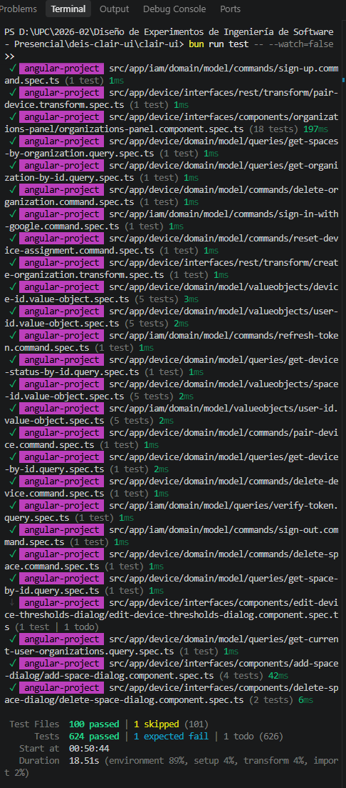

**User Stories web sin test unitario (y por qué).**

| User Story | Razón | Acción futura |
|---|---|---|
| WA-US-01 / WA-US-02 Registro y verificación | Lógica en el backend; el frontend solo reenvía | Cubierto por e2e si se añade endpoint de seed |
| WA-US-05 Google SSO | Requiere interacción real con Google | Se mockea a nivel de service y se cubre en e2e |
| `edit-device-thresholds-dialog.component` | Usa `inject()` con 7 dependencias y `ChangeDetectorRef`; se dejó como `it.todo` | Refactor para aislar la lógica testeable |
| `space-devices-page.component` | 8 dependencias inyectadas, timers y suscripciones; el esfuerzo/beneficio no justificó cubrirlo en unit | Cubierto indirectamente por `space-devices-page-actions.service` |

**Ejecución.**

```bash
# Toda la suite:
bun run test -- --watch=false

# Un archivo específico:
bun run test -- src/app/iam/domain/model/valueobjects/email.value-object.spec.ts --watch=false

# Modo watch (desarrollo):
bun run test
```

**Evidencia de commits.**

| Repository | Branch | Commit Id | Commit Message | Committed on |
|---|---|---|---|---|
| bananawire/clair-ui | `test/unit-tests-luis` | `4e64ff9` | `test(device): add gateway, facade and outbound service specs` | 2026-10-05 |
| bananawire/clair-ui | `test/unit-tests-luis` | `ff7b147` | `test(iam): add value object specs (user-id, password, verification-code, tokens)` | 2026-10-05 |
| bananawire/clair-ui | `test/unit-tests-luis` | `eed6d90` | `test(iam): add command and query specs` | 2026-10-05 |
| bananawire/clair-ui | `test/unit-tests-luis` | `cc2b5f1` | `test(iam): add auth transform spec` | 2026-10-05 |
| bananawire/clair-ui | `test/unit-tests-luis` | `886151d` | `test(iam): add auth command and query service specs` | 2026-10-05 |
| bananawire/clair-ui | `test/unit-tests-luis` | `6a8262a` | `test(iam): add token storage and http gateway specs` | 2026-10-05 |
| bananawire/clair-ui | `test/unit-tests-luis` | `9964a57` | `test(iam): add auth guard and http interceptor specs` | 2026-10-05 |
| bananawire/clair-ui | `test/unit-tests-luis` | `c513236` | `test(device): add value object specs` | 2026-10-05 |
| bananawire/clair-ui | `test/unit-tests-luis` | `3701c8f` | `test(device): add command specs (batch 1)` | 2026-10-05 |
| bananawire/clair-ui | `test/unit-tests-luis` | `41afee5` | `test(device): add query specs` | 2026-10-05 |
| bananawire/clair-ui | `test/unit-tests-luis` | `953c3db` | `test(device): add transform specs (connectivity color, api error)` | 2026-10-05 |
| bananawire/clair-ui | `test/unit-tests-luis` | `b8aaec7` | `add testing` | 2026-10-05 |
| bananawire/clair-ui | `test/unit-tests-luis` | `6c394c8` | `ci: add workflow for unit tests and build` | 2026-10-05 |
| bananawire/clair-ui | `test/unit-tests-luis` | `4d0ed09` | `ci: simplify workflow to run unit tests only` | 2026-10-06 |

También se incluye la sección siguiente para cubrir el flujo de integración
continua exigido por el capítulo VII.

#### 6.1.3.2. Prubas con Playwright

Video Demo con Playwright

https://youtu.be/-FPnRmG9cCE

[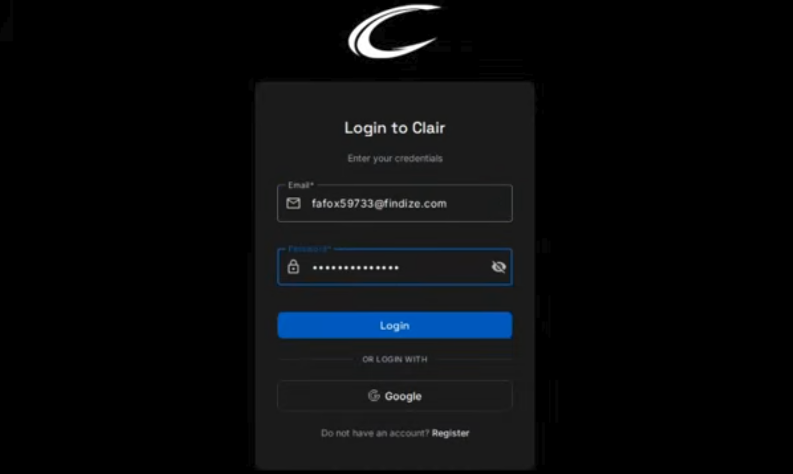](https://youtu.be/-FPnRmG9cCE)

La aplicación web de Clair (Angular 21, `clair-ui`) se prueba con una suite de sistema construida con Playwright. Igual que las pruebas Patrol de la app móvil, recorre la UI real y golpea el backend `clair-core` desplegado (`https://clair-api.giks.net`); no se usa ningún mock, ningún token falso ni interceptación de red.

| Suite | Nivel | Aísla | Tecnología | Pruebas |
|---|---|---|---|---|
| System Tests (Playwright) | App web completa contra el backend real | Front local (`ng serve`) con proxy de `/api` al backend; Chromium (Desktop Chrome) | Playwright + TypeScript | 1 (1 archivo) |

Alcance de la suite:

- Cubre el núcleo del producto: **IAM (inicio de sesión)** y **Devices** (organización, espacio, dispositivo, configuración y limpieza). Registro, billing, alertas, analítica y reportes quedan fuera de esta suite.
- La cuenta de pruebas y el hardware del seed van fijos en el archivo de la prueba: cuenta E2E dedicada y `CLAIR-0003`, uno de los cinco sensores del seed del backend (`V9__seed__device__demo_inventory.sql`).
- El claim token no está en el seed: se obtiene al emparejar el hardware. La prueba lo lee del aviso que muestra la app (`Sensor paired. Claim token: ...`) y lo usa en el paso de reclamar.

**Estructura del directorio `clair-ui/`.**

```
clair-ui/
├── playwright.config.ts          # un proyecto (devices), video y trace siempre activos
└── tests/
    ├── devices.spec.ts           # recorrido completo: login → devices → limpieza
    └── proxy.conf.json           # proxy de /api hacia clair-api.giks.net
```

**Recorrido de `tests/devices.spec.ts`.**

Un solo `test` ejecuta el camino feliz completo. Los nombres de la organización y del espacio llevan un sufijo con la marca de tiempo, de modo que cada corrida crea sus propios recursos y al final solo borra esos.

| Paso | Acción en la UI | User Story | Verificación observable |
|---|---|---|---|
| 1 | Iniciar sesión con la cuenta E2E | WA-US-03 | La URL sale de `/login` |
| 2 | Crear organización | WA-US-09 | Aviso `Organization created` |
| 3 | Crear espacio dentro de la organización | WA-US-13 | Aviso `Space created`; el espacio aparece vacío |
| 4 | Emparejar `CLAIR-0003` por hardware ID | WA-US-18 | Aviso `Sensor paired` con el claim token |
| 5 | Reclamar el dispositivo en el espacio con ese token | WA-US-17 | Aviso `Sensor claimed` |
| 6 | Renombrar el dispositivo | WA-US-19 | Aviso `Device updated` |
| 7 | Ajustar los cuatro umbrales (PM2.5, CO₂, temperatura, humedad) | WA-US-30 / WA-US-31 | Aviso `Thresholds saved` |
| 8 | Liberar el dispositivo (`Delete Device`) | WA-US-21 | Aviso `Device deleted`; el espacio vuelve a quedar sin dispositivos |
| 9 | Eliminar el espacio | WA-US-15 | Aviso `Space deleted` |
| 10 | Eliminar la organización | WA-US-11 | Aviso `Organization deleted`; la organización desaparece del panel |

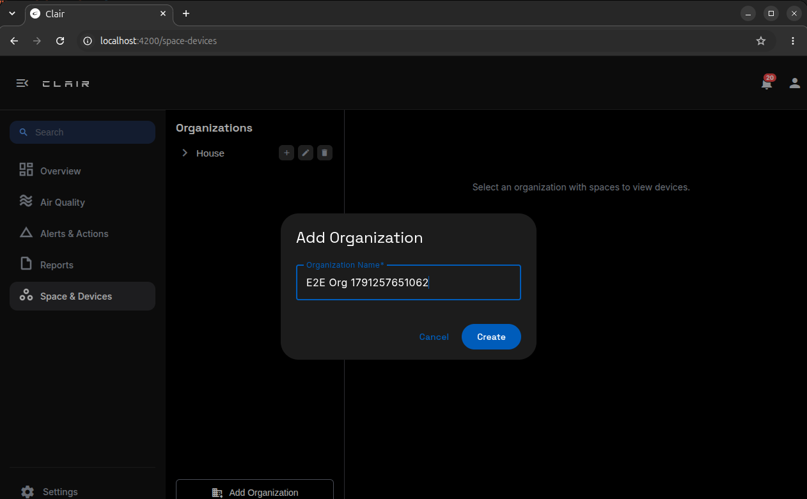

**Limpieza.** Los pasos 8 a 10 devuelven el sistema al estado inicial y permiten repetir la prueba sin intervención manual. En `clair-core`, `DELETE /api/v1/devices/{id}` no elimina el sensor: resetea su asignación (`ResetDeviceAssignmentCommand`), lo desvincula del espacio y le devuelve el nombre de fábrica, por lo que `CLAIR-0003` queda disponible para la siguiente corrida. El backend limita a 3 las organizaciones por usuario (`409: User has 3 organizations, max allowed is 3`); por eso la prueba no deja organizaciones residuales.

**Video y reporte.** El proyecto está configurado con `video: 'on'` y `trace: 'on'`, con una pausa de 1 s entre acciones (`slowMo`) para que el recorrido pueda seguirse. El `.webm` queda en `test-results/` y también dentro del reporte HTML. Como el inicio de sesión está dentro del mismo test, un único video cubre todo el recorrido.

**User Stories web pendientes sin test E2E (y por qué).**

| User Story | Razón | Acción futura |
|---|---|---|
| WA-US-01 / WA-US-02 Registro y verificación | Requiere interceptar el código de verificación enviado por correo | Endpoint de seed o buzón de pruebas en CI |
| WA-US-05 Google SSO | No existe modo de prueba de Google Sign-In en CI | Cuenta de prueba dedicada o fake id token |
| Billing, alertas, analítica y reportes | Fuera del alcance acordado para esta suite (solo core: IAM y Devices) | Ampliar la suite si el alcance cambia |
| Casos de error del servidor (500, listas vacías forzadas) | Sin mocks no se puede forzar el fallo del backend real | Cubrirlos en pruebas de backend |

**Ejecución.**

```bash
# Toda la suite (levanta el front local con proxy al backend real):
npx playwright test

# Ver el recorrido en vivo:
npx playwright test --headed

# Modo interactivo, paso a paso:
npx playwright test --ui

# Reporte HTML con video y trace:
npx playwright show-report
```

## 6.2. Static testing & Verification

### 6.2.1. Static Code Analysis

#### 6.2.1.1. Coding standard & Code conventions.

La verificación estática de Clair no ejecuta la aplicación ni repite las suites dinámicas de la sección 6.1. Inspecciona el código antes de que un cambio entre a `develop` o a `main`, para detectar desviaciones de estilo, problemas de mantenibilidad y riesgos de seguridad sin levantar el sistema. Las guías ya quedaron decididas en la sección 5.1.3; aquí se comprueba que esas decisiones se aplican. En `clair-core`, Spotless y Checkstyle verifican Google Java Style: clases en UpperCamelCase, métodos y variables en lowerCamelCase, paquetes alineados a los bounded contexts y una longitud de línea que permita la revisión. En `clair-ui`, ESLint con `angular-eslint` y Prettier verifican la guía de Angular, el modo estricto de TypeScript y el patrón `nombre.component.ts`. En la aplicación móvil, `dart format` y `flutter analyze` verifican Effective Dart y tratan los avisos como fallo. En el edge, Ruff verifica PEP 8. En la landing page, HTMLHint y Stylelint verifican la guía de Google para HTML y CSS y las clases BEM en inglés. La nomenclatura del código permanece en inglés en todos los lenguajes. En Gherkin, la convención que se verifica es la que ejecutan las suites de la sección 6.1: features en español con `Dado`, `Cuando` y `Entonces`, aunque la sección 5.1.3 las haya descrito en inglés. Cada producto conserva su archivo de configuración y el comando que GitHub Actions ejecuta en el Pull Request; la evidencia de esta subsección es la captura del job en verde, no una nueva declaración de la guía.

#### 6.2.1.2. Code Quality & Code Security.

La calidad y la seguridad se concentran en un Quality Gate de SonarQube, de modo que Java, TypeScript y Dart se evalúen con los mismos umbrales y el Pull Request falle si el código nuevo no los cumple. En calidad se miden la complejidad ciclomática, la duplicación, los code smells y la deuda técnica. El umbral del código nuevo es ningún bug nuevo y una duplicación inferior al tres por ciento, aplicado a las reglas que ya protegen las pruebas: la severidad de una alerta, el cupo de espacios según el plan y el aislamiento entre organizaciones. En seguridad se controla que no haya secretos en el fuente, que las entradas se validen contra inyección, que las lecturas de telemetría no se acepten sin validar y que los datos de JWT, sesiones, Stripe, Google y OneSignal no queden expuestos. La evidencia es la captura del Quality Gate y el paso de GitHub Actions que rechaza el Pull Request cuando el gate no pasa. No se reporta un puntaje ni una cantidad de vulnerabilidades que el análisis aún no haya producido. Si SonarQube no puede levantarse, el sustituto es SpotBugs con OWASP Dependency-Check en Java, las reglas de seguridad de ESLint en Angular y `dart analyze` en Flutter, y esa sustitución se declara de forma explícita.

### 6.2.2. Reviews

La revisión por pares no vuelve a definir GitFlow. Fija la regla con la que un cambio entra al repositorio. Ningún integrante fusiona directamente en `develop` ni en `main`. Una rama `feature/*` termina en un Pull Request que exige la aprobación de al menos un revisor distinto del autor y el resultado verde de la integración continua, incluidas las suites de la sección 6.1 y el análisis de esta sección. El revisor comprueba las convenciones, la coherencia con la regla de negocio y que la prueba asociada cubra la User Story. La evidencia es la configuración de branch protection y un Pull Request real con comentarios, aprobación y checks, no una definición abstracta del procedimiento. El cambio solo se integra cuando coinciden la aprobación humana y la verificación automática, de modo que la calidad no dependa de la memoria de quien escribe el código.

## 6.3. Validation Interviews.

### 6.3.1. Diseño de Entrevistas.

#### 6.3.1.1. Objetivo y alcance de la validación

**Objetivo general:** Validar con usuarios representativos de ambos segmentos que la solución Clair cumple con los atributos de usabilidad, comprensibilidad y utilidad esperados, y detectar oportunidades de mejora antes del lanzamiento oficial.

**Objetivos específicos:**

1. Verificar que el visitante comprende la propuesta de valor y el modelo de precios de Clair en la Landing Page en menos de 60 segundos.
2. Confirmar que el **Facility Admin** puede completar el flujo crítico de gestión (crear organización → crear espacio → vincular dispositivo → configurar umbral) sin asistencia del moderador.
3. Confirmar que el **Home User** puede interpretar el estado del aire y reaccionar ante una alerta desde la Mobile App.
4. Evaluar la percepción de confianza, claridad y accesibilidad del sistema en ambos segmentos.
5. Recoger insumos cualitativos y cuantitativos que alimenten la evaluación heurística descrita en la sección **6.3.3**.

**Alcance de la validación:**

| Componente validado | Segmento principal | User Goals cubiertos |
|---|---|---|
| Landing Page (comprensión de propuesta y precios) | Ambos | — |
| Web Application — gestión de organizaciones, espacios y dispositivos | Facility Admin | UG01, UG02, UG03 |
| Web Application — Rules Builder y umbrales | Facility Admin | UG03, UG04 |
| Web Application — Analytics y Reports | Facility Admin | UG02, UG05 |
| Mobile Application — Dashboard y alertas | Home User | UG01, UG04, UG06 |
| Mobile Application — Settings y notificaciones | Home User | UG04, UG06 |

#### 6.3.1.2. Perfil de los participantes

Se convocará a **6 participantes** (3 por segmento), siguiendo la recomendación de Nielsen de que **3 usuarios por segmento permiten detectar aproximadamente el 66 % de los problemas de usabilidad** en una misma interfaz.

**Segmento 1 — Facility Admins:**

| Criterio | Detalle |
|---|---|
| Rol | Administradores, dueños o responsables de establecimientos comerciales (retail, gimnasios, restaurantes, coworkings, laboratorios) |
| Ubicación | Lima Metropolitana |
| Experiencia digital | Uso cotidiano de smartphone y al menos una herramienta web de gestión (POS, CRM, hojas de cálculo) |
| Conocimiento previo de Clair | Ninguno (usuarios nuevos) |
| Criterio de exclusión | Personas que hayan participado en el diseño del producto o en las entrevistas del Capítulo II en calidad de *stakeholders* técnicos |

**Segmento 2 — Home Users:**

| Criterio | Detalle |
|---|---|
| Rol | Adultos responsables del bienestar del hogar, con o sin sensibilidad respiratoria propia o de un conviviente |
| Ubicación | Lima Metropolitana |
| Experiencia digital | Uso cotidiano de smartphone; familiaridad con apps de salud, clima o domótica |
| Conocimiento previo de Clair | Ninguno (usuarios nuevos) |
| Criterio de exclusión | Personas con formación técnica en calidad del aire que pudieran sesgar la interpretación de los datos |

**Reclutamiento:** se invitará A **6 participantes nuevos**, contactados por recomendación y redes del equipo.

#### 6.3.1.3. Guion de la entrevista

El guion se estructura en **seis bloques** y se adapta ligeramente según el segmento. Los tiempos son referenciales.

**Bloque 0 — Bienvenida y consentimiento (5 min)**

- Agradecimiento y presentación del equipo.
- Explicación del objetivo: *"Vamos a mostrarte Clair, un sistema de monitoreo de calidad del aire. Queremos saber qué tu opinión, no evaluamos tus conocimientos."*
- Consentimiento informado.
- Confirmación del permiso de grabación.
- Recordatorio del *think-aloud*: *"Mientras navegas, cuéntanos en voz alta lo que piensas, lo que esperas que ocurra y lo que te confunde."*

**Bloque 1 — Perfil del participante**

Preguntas Iniciales:
- 1. ¿A qué te dedicas y cómo es un día típico en tu hogar / establecimiento?
- 2. ¿Qué dispositivos digitales usas con más frecuencia?
- 3. ¿Cómo cuidas hoy la calidad del a ire (si aplica) o cómo decides ventilar?

**Bloque 2 — Landing Page: primera impresión (10 min)**

- Abrir la Landing Page en un navegador limpio.
- *"Sin hacer clic todavía, dime qué crees que hace Clair y para quién es."*
- *"Encuentra cuánto cuesta y qué incluye el plan gratuito vs. el premium."*

Preguntas posteriores:
- 4. ¿En tus propias palabras, qué es Clair?
- 5. ¿Qué parte de la propuesta de valor te generó más confianza? ¿Alguna te generó dudas?
- 6. ¿La información de precios te pareció clara? ¿Faltó algo?
- 7. ¿Qué tan probable es que dejes tus datos de contacto aquí del 1 al 5? ¿Por qué?

**Bloque 3 — Web App: flujo de administrador (solo Segmento 1)**

Tareas secuenciales (think-aloud):
- **T1:** Inicia sesión con las credenciales demo y crea una organización llamada *"Sucursal Demo"*.
- **T2:** Crea un espacio llamado *"Sala de Reuniones"* dentro de esa organización.
- **T3:** Empareja el dispositivo *CLAIR-DEMO* y reclámalo en ese espacio.
- **T4:** Configura el umbral de PM2.5 en **50 µg/m³**.
- **T5:** Interpreta el panel de *Air Quality* y dime si el aire del espacio está en estado saludable, moderado o crítico.
- **T6:** Navega a *Alerts & Actions* y revisa si hay alertas activas. Si hay una, descríbeme qué harías.

Preguntas de refuerzo:
- 8. ¿Qué fue lo más fácil? ¿Y lo más confuso?
- 9. ¿En algún momento sentiste que el sistema no te decía qué hacer a continuación?
- 10. ¿Confiarías en la información que muestra el dashboard para tomar una decisión? ¿Por qué?
- 11. Si pudieras cambiar una sola cosa de esta pantalla, ¿cuál sería?

**Bloque 4 — Mobile App: flujo de usuario del hogar (solo Segmento 2)**

Tareas secuenciales (think-aloud):
- **T1:** Inicia sesión en la Mobile App con las credenciales demo.
- **T2:** En el Dashboard, dime si el aire de tu hogar está en buen estado y por qué.
- **T3:** Cambia el rango de fechas a *"Semana"* y describe qué observas en la tendencia.
- **T4:** Abre el detalle de un sensor e identifica los valores de PM2.5, CO₂ y humedad.
- **T5:** Configura una regla personalizada: *"Cuando el CO₂ supere 1000 ppm, avísame."*
- **T6:** Imagina que recibes una notificación push de alerta crítica. Ábrela y dime qué harías.

Preguntas de refuerzo:
- 12. ¿Qué tan fácil fue configurar una regla de alerta sin ayuda?
- 13. ¿Los colores y las etiquetas del estado del aire te resultaron comprensibles? ¿Habría otra forma de mostrarlo que te resultara más clara?
- 14. ¿Qué te pareció el tamaño de los textos, los botones y la navegación inferior?
- 15. ¿Usarías esta app a diario? ¿Semanalmente? ¿Por qué?

**Bloque 5 — Validación general**

Preguntas comunes a ambos segmentos:
- 16. En una escala del 1 al 5, ¿qué tan útil te pareció Clair para el problema que te describimos al inicio?
- 17. ¿Qué tan probable es que lo recomiendes a un colega / familiar? (escala 1–10, NPS)
- 18. ¿Hubo algún término técnico que no entendieras?
- 19. ¿Qué funcionalidad sentiste que faltaba?
- 20. ¿Algo de la interfaz te generó desconfianza o incomodidad?
- 21. ¿Hay algo más que quieras comentarnos antes de terminar?

**Bloque 6 — Cierre**

- Agradecimiento.

#### 6.3.1.5. Matriz de tareas ↔ User Goals ↔ User Stories

Esta matriz asegura que cada tarea del guion está justificada por el backlog y por los objetivos de usuario definidos en el Capítulo IV.

| ID | Tarea del guion | User Goal | User Stories asociadas | Componente |
|---|---|---|---|---|
| T1 | Crear organización | UG02 | WA-US-09 | Web App |
| T2 | Crear espacio | UG02 | WA-US-13 | Web App |
| T3 | Emparejar y reclamar dispositivo | UG01 | WA-US-17, WA-US-18 | Web App |
| T4 | Configurar umbral PM2.5 | UG04 | WA-US-30 | Web App |
| T5 | Interpretar panel Air Quality | UG01, UG03 | WA-US-42, WA-US-47 | Web App |
| T6 | Revisar alertas activas | UG01 | WA-US-34, WA-US-35 | Web App |
| T7 | Interpretar Dashboard Mobile | UG06 | MA-US-23, MA-US-24 | Mobile App |
| T8 | Cambiar rango de fechas en tendencia | UG05 | MA-US-26 | Mobile App |
| T9 | Abrir detalle de sensor | UG04 | MA-US-23 | Mobile App |
| T10 | Configurar regla de alerta | UG04 | MA-US-16 | Mobile App |
| T11 | Reaccionar a notificación push | UG01, UG04 | MA-US-22, MA-US-27 | Mobile App |


#### 6.3.1.6. Criterios de evaluación que alimentan la sección 6.3.3

Los datos recogidos en cada sesión se consolidan para la evaluación heurística según los **10 principios de Nielsen**. La correspondencia es la siguiente:

| Heurística de Nielsen | Evidencia recogida en la entrevista |
|---|---|
| H1. Visibilidad del estado del sistema | T5, T6, T7, T11 — ¿el usuario sabe en qué estado está el aire y el sistema? |
| H2. Correspondencia entre sistema y mundo real | Preguntas 4, 13, 18 — lenguaje y metáforas usadas |
| H3. Control y libertad del usuario | T1–T6, T8 — posibilidad de deshacer, cancelar, volver |
| H4. Consistencia y estándares | Observación de patrones en Landing, Web y Mobile |
| H5. Prevención de errores | T4, T10 — validaciones y mensajes |
| H6. Reconocimiento antes que recuerdo | T5, T7 — ¿el usuario recuerda datos o los ve? |
| H7. Flexibilidad y eficiencia de uso | T6, T8, T11 — atajos, filtros, acciones rápidas |
| H8. Diseño estético y minimalista | Preguntas 5, 11, 14 — percepción visual |
| H9. Ayuda al usuario a reconocer, diagnosticar y recuperarse de errores | T4, T10 — mensajes de error |
| H10. Ayuda y documentación | Pregunta 19 — ¿faltó ayuda contextual? |

Los resultados cuantitativos (SUS, tiempos, tasa de éxito) y cualitativos (citas, observaciones) se presentarán en **6.3.2 Registro de Entrevistas** y se sintetizarán en **6.3.3 Evaluación según heurísticas**.

## 6.3.2. Registro de Entrevistas.

## 6.3.2.1. Sesión VI-01 — Administrador de tienda comercial

**Datos del participante:**

| Campo                                    | Detalle                                                         |
|------------------------------------------|-----------------------------------------------------------------|
| ID de sesión                             | VI-01                                                           |
| Sexo                                     | Varón                                                           |
| Edad                                     | 32 años                                                         |
| Ocupación                                | Administrador de tienda de productos                            |
| Rol en el establecimiento                | Administrador                                                   |
| Experiencia digital                      | Uso cotidiano de celular y computadora para gestión del negocio |
| Conocimiento previo de Clair             | Ninguno                                                         |
| Consentimiento informado                 | Sí                                                              |
| Grabación autorizada                     | Sí                                                              |
| Link de la grabación                     | [[Enlace](https://drive.google.com/file/d/1OfZdCIdc8XxxFVLToAjkFliKZeVWlzoe/view?usp=sharing)](#) |

**Respuestas por bloque del guion:**

| Bloque | Pregunta | Respuesta del participante |
|---|---|---|
| Perfil | ¿A qué se dedica y cómo es un día normal? | Administra una tienda; supervisa ventas, atiende proveedores y organiza productos. Nota que el ambiente se siente "más cargado" cuando hay mucha gente. |
| Perfil | ¿Qué dispositivos usa? ¿Cómo controla la ventilación? | Celular y computadora. Abre puertas o ventanas cuando siente calor o hay demasiadas personas. |
| Landing | Primera impresión de Clair | Lo percibe como un sistema que permite conocer si el aire de un establecimiento está limpio o contaminado. |
| Landing | ¿Qué genera más confianza? ¿Precios claros? | Valora el monitoreo en tiempo real. Sobre precios, pide claridad sobre el costo del dispositivo y si hay pago mensual. |
| Web App | ¿Qué esperaría ver en el panel? | Indicadores fáciles de entender, colores que indiquen si el aire está bien o mal, y recomendaciones para solucionar el problema. |
| Web App | ¿Confiaría en las alertas? | Sí, siempre que las mediciones sean precisas. Le ayudaría a ventilar con criterio y no solo por sensación térmica. |
| Cierre | Utilidad (1–5) y recomendación | **4 / 5**. Lo recomendaría a otros administradores, especialmente si permite recibir alertas al celular. |

**Citas literales relevantes:**

> *"Normalmente uno no puede saber eso solamente mirando el ambiente."*
> *"Esperaría encontrar indicadores fáciles de entender, colores que indiquen si el aire está bien o mal y alguna recomendación para solucionar el problema."*
> *"Me ayudaría a saber cuándo ventilar, en lugar de hacerlo solamente cuando siento que hace calor."*

**Hallazgos:**

| ID | Hallazgo | Tipo | Severidad | Componente |
|---|---|---|---|---|
| H-VI01-01 | El monitoreo en tiempo real es el principal generador de confianza en la propuesta de valor. | Positivo | — | Landing Page |
| H-VI01-02 | El participante no encontró explícito en la primera vista el costo del dispositivo ni la existencia de un pago mensual. | Oportunidad de mejora | Media | Landing Page — Pricing |
| H-VI01-03 | Espera recomendaciones accionables (qué hacer) además del valor numérico en el panel. | Requisito de diseño | Media | Web App — Air Quality |
| H-VI01-04 | La confianza en las alertas depende de la percepción de precisión del sensor. | Requisito de confianza | Media | Web App / Mobile |
| H-VI01-05 | Prefiere recibir alertas en el celular antes que tener que revisar el panel web. | Oportunidad de mejora | Baja | Mobile App |

**Puntaje de utilidad percibida:** 4 / 5
**Intención de recomendación:** Sí

---

## 6.3.2.2. Sesión VI-02 — Encargado de cafetería

**Datos del participante:**

| Campo | Detalle                                                                                    |
|---|--------------------------------------------------------------------------------------------|
| ID de sesión | VI-02                                                                                      |
| Sexo | Varón                                                                                      |
| Edad | 38 años                                                                                    |
| Ocupación | Encargado de cafetería                                                                     |
| Rol en el establecimiento | Encargado (personal, pedidos y atención al cliente)                                        |
| Experiencia digital | Uso de dispositivos para gestión del local; no cuenta con equipos de medición ambiental    |
| Conocimiento previo de Clair | Ninguno                                                                                    |
| Consentimiento informado | Sí                                                                                         |
| Grabación autorizada | Sí                                                                                         |
| Link de la grabación | [[Enlace](https://drive.google.com/file/d/1Fuxax8y_XrHL4jum0VNuOOqwas0Cs9x2/view?usp=sharing)](#)                                                                            |

**Respuestas por bloque del guion:**

| Bloque | Pregunta | Respuesta del participante |
|---|---|---|
| Perfil | ¿Cuál es su función y cómo es un día habitual? | Encargado de cafetería; gestiona personal, pedidos y atención al cliente. En horas punta el ambiente se vuelve "caluroso o cargado". |
| Perfil | ¿Cómo controlan actualmente la ventilación? | Usan ventiladores y algunas ventanas. No tienen ningún equipo que mida la calidad del aire. |
| Landing | ¿Qué entiende que hace Clair? | Lo interpreta como una herramienta para medir la contaminación del aire dentro de establecimientos. Valora el impacto en trabajadores y clientes que permanecen varias horas en el mismo espacio. |
| Landing | ¿Qué característica le interesa más? ¿Qué dudas tiene? | Le interesa recibir alertas cuando la calidad del aire empeore. Sus dudas son el costo y si la instalación requiere un técnico. |
| Web App | ¿Qué información le gustaría encontrar primero en el panel? | Ver rápidamente si el ambiente está saludable, si hay exceso de CO₂ o partículas, y qué hacer para mejorar. |
| Web App | Si recibe una alerta crítica, ¿qué haría? | Verificaría la alerta, abriría ventanas o mejoraría la ventilación y avisaría al personal. |
| Cierre | Facilidad de uso y frecuencia | Considera que sería fácil si la interfaz es sencilla. La revisaría **diariamente antes de la jornada y durante las horas de mayor actividad**. |
| Cierre | Utilidad (1–5) | **5 / 5**, condicionado a que las mediciones sean confiables. |

**Citas literales relevantes:**

> *"En un restaurante hay trabajadores y clientes que permanecen varias horas en el mismo espacio."*
> *"Mi principal duda sería el costo y si instalar el dispositivo requiere contratar a un técnico."*
> *"Quisiera ver rápidamente si el ambiente está saludable, si hay demasiado CO₂ o partículas y qué debería hacer para mejorar las condiciones."*
> *"La revisaría diariamente antes de comenzar la jornada y durante las horas de mayor actividad."*

**Hallazgos:**

| ID | Hallazgo | Tipo | Severidad | Componente |
|---|---|---|---|---|
| H-VI02-01 | La ausencia actual de cualquier equipo de medición ambiental refuerza el valor percibido de Clair. | Positivo | — | Propuesta de valor |
| H-VI02-02 | Existe incertidumbre sobre el **costo total** y sobre si la **instalación requiere un técnico**. | Oportunidad de mejora | Alta | Landing Page — Pricing / Onboarding |
| H-VI02-03 | Espera ver primero un **resumen del estado** (saludable / no saludable) antes que los valores numéricos. | Requisito de diseño | Media | Web App — Air Quality |
| H-VI02-04 | Espera **recomendaciones accionables** junto a la alerta (abrir ventanas, avisar al personal). | Requisito de diseño | Media | Web App / Mobile |
| H-VI02-05 | Proyecta un uso **diario y recurrente** (antes de la jornada y en horas punta), lo que valida la frecuencia de uso hipotética del segmento. | Positivo | — | Web App |
| H-VI02-06 | La confianza en el sistema depende de la **percepción de precisión** del sensor. | Requisito de confianza | Media | Landing / Web App |

**Puntaje de utilidad percibida:** 5 / 5 (condicionado a fiabilidad de las mediciones)
**Intención de recomendación:** No se preguntó explícitamente; se infiere positiva por el puntaje y el cierre.

---

## 6.3.2.3. Sesión VI-03 — Administrador de local de servicios

**Datos del participante:**

| Campo | Detalle |
|---|---|
| ID de sesión | VI-03 |
| Sexo | Varón |
| Edad | 29 años |
| Ocupación | Administrador de un pequeño local de servicios |
| Rol en el establecimiento | Responsable del local |
| Experiencia digital | Uso cotidiano de laptop y celular para gestión |
| Conocimiento previo de Clair | Ninguno |
| Consentimiento informado | Sí |
| Grabación autorizada | Sí |
| Link de la grabación | [[Enlace](https://drive.google.com/file/d/1Ykeqz6M4I1TeI9K124xSAyJaQMSgKS__/view?usp=sharing)](#) |

**Respuestas por bloque del guion:**

| Bloque | Pregunta | Respuesta del participante |
|---|---|---|
| Perfil | ¿A qué se dedica y cómo es el ambiente donde trabaja? | Administra un pequeño local de servicios. Trabaja con 4 personas y pasan toda la jornada dentro. No tienen mucha ventilación natural. |
| Perfil | ¿Qué dispositivos usa? ¿Cómo sabe cuándo ventilar? | Usa laptop y celular. Abren la puerta cuando sienten que el ambiente está "encerrado", sin medición objetiva. |
| Landing | ¿Qué cree que ofrece Clair? | Lo interpreta como una plataforma para monitorear indicadores del aire y saber si el espacio tiene buenas condiciones ambientales. |
| Landing | ¿Qué le parece la propuesta? ¿Qué dudas tiene? | Le parece útil porque aporta información que normalmente se desconoce. Sus dudas: **precisión de los sensores** y **costo de mantener el servicio**. |
| Web App | ¿Qué esperaría encontrar en el panel? | Un **resumen general del ambiente**, las **mediciones de cada sensor** y un **historial** para comparar la evolución semanal. |
| Web App | Si recibe una alerta de PM2.5 elevado, ¿qué haría? | Revisaría qué tan elevado está el indicador, comprobaría fuentes de polvo o contaminación y trataría de ventilar. |
| Cierre | ¿Qué mejoraría de Clair? | **Agregaría recomendaciones concretas**: no solo indicar que el aire está mal, sino explicar qué acciones tomar. |
| Cierre | Utilidad (1–5) | **4 / 5**, condicionado a que el mantenimiento sea bajo y las recomendaciones fáciles de entender. |

**Citas literales relevantes:**

> *"Generalmente abrimos la puerta cuando sentimos que el ambiente está encerrado, pero no tenemos ninguna medición objetiva."*
> *"Quisiera saber qué tan precisos son los sensores y cuánto cuesta mantener el servicio."*
> *"Agregaría recomendaciones concretas. No solamente indicar que el aire está mal, sino explicar qué acciones podemos realizar para mejorarlo."*
> *"Lo utilizaría si no requiere demasiado mantenimiento y si las recomendaciones son fáciles de entender."*

**Hallazgos:**

| ID | Hallazgo | Tipo | Severidad | Componente |
|---|---|---|---|---|
| H-VI03-01 | La ausencia de medición objetiva refuerza la propuesta de valor de Clair en locales pequeños. | Positivo | — | Propuesta de valor |
| H-VI03-02 | Persiste la duda sobre la **precisión de los sensores** y el **costo de mantenimiento**. | Oportunidad de mejora | Alta | Landing / Documentación |
| H-VI03-03 | Espera un **resumen general** antes que el detalle por sensor. | Requisito de diseño | Media | Web App — Air Quality |
| H-VI03-04 | Valora el **historial semanal** para comparar la evolución del ambiente. | Requisito de diseño | Media | Web App — Analytics / Reports |
| H-VI03-05 | Refuerza la necesidad de **recomendaciones concretas** junto a la alerta. | Requisito de diseño | Alta | Web App / Mobile |
| H-VI03-06 | El **mantenimiento bajo** es un criterio de adopción explícito. | Requisito no funcional | Media | Producto / Soporte |

**Puntaje de utilidad percibida:** 4 / 5 (condicionado a bajo mantenimiento y recomendaciones claras)
**Intención de recomendación:** No se preguntó explícitamente; se infiere positiva por la disposición de uso.

---

## 6.3.2.4. Sesión VI-04 — Hombre que vive con su familia

**Datos del participante:**

| Campo | Detalle                                                                                                                                                               |
|---|-----------------------------------------------------------------------------------------------------------------------------------------------------------------------|
| ID de sesión | VI-04                                                                                                                                                                 |
| Sexo | Varón                                                                                                                                                                 |
| Edad | 35 años                                                                                                                                                               |
| Ocupación | Trabajador dependiente (no especifica rubro)                                                                                                                          |
| Composición del hogar | Esposa y dos hijos                                                                                                                                                    |
| Experiencia digital | Uso frecuente de celular; sin dispositivos de medición ambiental en casa                                                                                              |
| Conocimiento previo de Clair | Ninguno                                                                                                                                                               |
| Consentimiento informado | Sí                                                                                                                                                                    |
| Grabación autorizada | Sí                                                                                                                                                                    |
| Link de la grabación | [[Enlace](https://drive.google.com/file/d/1ZSzI9_VMVX7UIy0jLzjQFU7ATQkK2nxw/view?usp=sharing)](#) |

**Respuestas por bloque del guion:**

| Bloque | Pregunta | Respuesta del participante |
|---|---|---|
| Perfil | ¿Cómo es un día habitual en su hogar? | Trabaja durante el día y al regresar pasa tiempo con su familia. Sus hijos están en casa por las tardes; le preocupa que tengan un ambiente adecuado. |
| Perfil | ¿Qué dispositivos usa? ¿Cómo controla la ventilación? | Usa bastante el celular. Abren ventanas por las mañanas o cuando sienten calor, pero **no saben realmente qué tan limpio está el aire**. |
| Landing | ¿Qué cree que hace Clair? | Lo interpreta como un sistema que permite conocer la calidad del aire de una vivienda mediante sensores. Le parece relevante porque *"uno puede estar respirando aire contaminado sin darse cuenta"*. |
| Landing | ¿Qué característica le parece más útil? ¿Qué dudas tiene? | Le interesan las **alertas y recomendaciones**, especialmente recibir una notificación cuando el aire de la habitación de sus hijos no esté en buenas condiciones. Su duda principal es el **costo del dispositivo**. |
| Mobile App | ¿Qué esperaría encontrar al ver el estado del aire? | Un **indicador sencillo** (verde si está bien, rojo si hay problema). **No quiere interpretar muchos números**. |
| Mobile App | Si recibe una alerta de CO₂ > 1000 ppm, ¿qué haría? | Abriría las ventanas para ventilar y luego revisaría si los niveles vuelven a bajar. |
| Mobile App | ¿Le resultaría fácil configurar una alerta desde el celular? | Sí, siempre que los **pasos sean sencillos** y no tenga que buscar demasiadas opciones. |
| Cierre | Utilidad (1–5) | **5 / 5**. La usaría **diariamente** si es fácil de manejar. |

**Citas literales relevantes:**

> *"Uno puede estar respirando aire contaminado sin darse cuenta."*
> *"Me gustaría recibir una notificación cuando el aire de la habitación de mis hijos no esté en buenas condiciones."*
> *"Esperaría ver un indicador sencillo, por ejemplo, verde si está bien y rojo si hay algún problema. No quisiera tener que interpretar muchos números."*
> *"Sí, siempre que los pasos sean sencillos y no tenga que buscar demasiadas opciones."*
> *"La utilizaría diariamente si es fácil de manejar."*

**Hallazgos:**

| ID | Hallazgo | Tipo | Severidad | Componente |
|---|---|---|---|---|
| H-VI04-01 | La **protección de los hijos** es el motivador principal de adopción. | Positivo | — | Propuesta de valor |
| H-VI04-02 | Valora explícitamente el **enfoque preventivo** ("respirar aire contaminado sin darse cuenta"). | Positivo | — | Landing / Mobile |
| H-VI04-03 | Prefiere **indicadores visuales simples** (semáforo verde/rojo) sobre valores numéricos. | Requisito de diseño | Alta | Mobile App — Dashboard |
| H-VI04-04 | Espera **alertas contextualizadas por espacio** (habitación de los hijos), no solo un estado global. | Requisito de diseño | Media | Mobile App — Notificaciones |
| H-VI04-05 | El **costo del dispositivo** sigue siendo la duda principal antes de adoptar. | Oportunidad de mejora | Alta | Landing Page — Pricing |
| H-VI04-06 | Requiere **flujos de configuración con pocos pasos** para crear reglas de alerta. | Requisito de usabilidad | Media | Mobile App — Rules Builder |
| H-VI04-07 | Declara intención de **uso diario** si la app es fácil de manejar. | Positivo | — | Mobile App |

**Puntaje de utilidad percibida:** 5 / 5
**Intención de recomendación:** No se preguntó explícitamente; se infiere positiva por el puntaje y el cierre.

---

## 6.3.2.5. Sesión VI-05 — Hombre que vive solo o con su pareja

**Datos del participante:**

| Campo | Detalle |
|---|---|
| ID de sesión | VI-05 |
| Sexo | Varón |
| Edad | 27 años |
| Ocupación | Trabaja y estudia |
| Composición del hogar | Vive solo o con su pareja (departamento) |
| Experiencia digital | Uso frecuente de celular, laptop y aplicaciones móviles |
| Conocimiento previo de Clair | Ninguno |
| Consentimiento informado | Sí |
| Grabación autorizada | Sí |
| Link de la grabación | [[Enlace](https://drive.google.com/file/d/1iL-eMCg3hDCmGkYI8ThPUTo8CTRVtnPu/view?usp=sharing)](#) |

**Respuestas por bloque del guion:**

| Bloque | Pregunta | Respuesta del participante |
|---|---|---|
| Perfil | ¿Cómo es su rutina diaria en casa? | Trabaja y estudia; pasa bastante tiempo frente a la computadora. Vive en un departamento y **mantiene las ventanas cerradas por el ruido de la calle** cuando trabaja. |
| Perfil | ¿Qué dispositivos usa? ¿Cómo decide cuándo ventilar? | Usa principalmente celular y laptop. Ventila cuando siente que el ambiente está "encerrado" o hace demasiado calor. |
| Landing | ¿Qué entiende que ofrece Clair? | Un sistema que usa sensores para medir componentes del aire y mostrar los resultados en una aplicación. Lo percibe orientado a personas que quieren controlar el ambiente de su casa. |
| Landing | ¿Qué le genera confianza o desconfianza? | Le da confianza el **acceso al historial de mediciones** y los datos en tiempo real. Sus dudas: **exactitud de los sensores** y **costo del equipo**. |
| Mobile App | ¿Qué información le gustaría ver primero? | Un **resumen del estado del aire**, las **mediciones principales** y una **gráfica** para comparar la semana. |
| Mobile App | ¿Le parece útil una alerta de CO₂ > 1000 ppm? | Sí, bastante: le permitiría **recibir una notificación mientras trabaja** sin revisar constantemente la app. |
| Mobile App | ¿Qué opina de colores, etiquetas y navegación? | Los colores ayudan **siempre que vayan acompañados de explicaciones**. Prefiere **no tener demasiadas pantallas ni información innecesaria**. |
| Cierre | Frecuencia de uso y utilidad (1–5) | **4 / 5**. La revisaría **algunas veces al día o al recibir una alerta**. Condiciona la adopción a un **precio accesible**. |

**Citas literales relevantes:**

> *"Normalmente mantengo las ventanas cerradas cuando estoy trabajando por el ruido de la calle."*
> *"Me daría confianza poder consultar el historial de mediciones, aunque quisiera saber qué tan exactos son los sensores y cuánto cuesta el equipo."*
> *"Así podría recibir una notificación mientras estoy trabajando y no tendría que estar revisando constantemente la aplicación."*
> *"Los colores ayudan bastante, siempre que estén acompañados de explicaciones."*
> *"Me gustaría que la aplicación no tuviera demasiadas pantallas ni información innecesaria."*

**Hallazgos:**

| ID | Hallazgo | Tipo | Severidad | Componente |
|---|---|---|---|---|
| H-VI05-01 | El **ruido de la calle** lleva a mantener ventanas cerradas, lo que refuerza la necesidad de monitoreo interior. | Positivo | — | Propuesta de valor |
| H-VI05-02 | El **historial de mediciones** es un generador de confianza explícito. | Positivo | — | Mobile App — Analytics |
| H-VI05-03 | Persiste la duda sobre **exactitud del sensor** y **costo del equipo**. | Oportunidad de mejora | Alta | Landing Page — Pricing / FAQ |
| H-VI05-04 | Prefiere **resumen + gráfica semanal** como primera vista. | Requisito de diseño | Media | Mobile App — Dashboard |
| H-VI05-05 | La **alerta push mientras trabaja** es el caso de uso más valorado. | Positivo | — | Mobile App — Notificaciones |
| H-VI05-06 | Los **colores deben ir acompañados de explicación textual**; no basta el semáforo. | Requisito de accesibilidad | Media | Mobile App — Air Quality |
| H-VI05-07 | Pide **simplicidad de navegación**: pocas pantallas, sin información innecesaria. | Requisito de usabilidad | Media | Mobile App — Navegación |
| H-VI05-08 | La adopción está condicionada a un **precio accesible**. | Oportunidad de mejora | Alta | Landing Page — Pricing |

**Puntaje de utilidad percibida:** 4 / 5 (condicionado a precio accesible)
**Intención de recomendación:** No se preguntó explícitamente; se infiere positiva por el puntaje y la disposición de uso.

---

## 6.3.2.6. Sesión VI-06 — Hombre que pasa bastante tiempo en casa

**Datos del participante:**

| Campo | Detalle                                                                                    |
|---|--------------------------------------------------------------------------------------------|
| ID de sesión | VI-06                                                                                      |
| Sexo | Varón                                                                                      |
| Edad | 42 años                                                                                    |
| Ocupación | Trabaja desde casa (home office)                                                           |
| Composición del hogar | No especifica; pasa muchas horas en oficina en casa                                        |
| Experiencia digital | Uso cotidiano de celular; sin dispositivos de medición ambiental                           |
| Conocimiento previo de Clair | Ninguno                                                                                    |
| Consentimiento informado | Sí                                                                                         |
| Grabación autorizada | Sí                                                                                         |
| Link de la grabación | [[Enlace](https://drive.google.com/file/d/162qxMJPrJQsvArMu9YYP19leXY6Mu6tm/view?usp=sharing)](#)                                                                            | 

**Respuestas por bloque del guion:**

| Bloque | Pregunta | Respuesta del participante |
|---|---|---|
| Perfil | ¿Cómo es su rutina y cuánto tiempo pasa dentro de casa? | Trabaja desde casa la mayor parte de la semana. Pasa muchas horas en su oficina y, según el clima, **mantiene las ventanas cerradas durante bastante tiempo**. |
| Perfil | ¿Cómo controla la ventilación? | Abre ventanas por las mañanas y usa ventiladores cuando hace calor. **No tiene forma de saber si el aire está en buenas condiciones**. |
| Landing | ¿Qué cree que hace Clair? | Un sistema para medir la calidad del aire y consultar resultados desde el celular. Le parece útil porque *"uno normalmente no presta atención a estos factores hasta que siente alguna molestia"*. |
| Landing | ¿Qué parte le genera mayor interés? | Conocer **niveles de CO₂ y partículas**. También un **historial** para saber si la ventilación realmente está mejorando las condiciones. |
| Mobile App | ¿Qué esperaría encontrar en el dashboard? | Un **indicador general del estado del aire**, los **valores de cada medición** y **recomendaciones sobre qué hacer** cuando algún indicador esté elevado. |
| Mobile App | Si recibe una alerta crítica, ¿cómo reaccionaría? | Revisaría qué indicador está elevado, seguiría las recomendaciones (abrir ventanas, buscar la fuente del problema). |
| Mobile App | Facilidad de uso y mejoras | Le parecería fácil **si tiene botones claros y explicaciones sencillas**. Mejoraría las **recomendaciones para que sean más específicas**, no solo estadísticas. |
| Cierre | Utilidad (1–5) y recomendación | **5 / 5**. Lo recomendaría **siempre que las mediciones sean confiables**. |

**Citas literales relevantes:**

> *"Uno normalmente no presta atención a estos factores hasta que siente alguna molestia."*
> *"Me gustaría tener un historial para saber si la ventilación realmente está mejorando las condiciones."*
> *"Mejoraría las recomendaciones para que sean más específicas y no solamente muestren estadísticas."*
> *"Sí lo recomendaría, siempre que las mediciones sean confiables."*

**Hallazgos:**

| ID | Hallazgo | Tipo | Severidad | Componente |
|---|---|---|---|---|
| H-VI06-01 | El **trabajo desde casa** y las ventanas cerradas refuerzan la necesidad de monitoreo interior. | Positivo | — | Propuesta de valor |
| H-VI06-02 | El **historial de mediciones** se percibe como evidencia de mejora tras ventilar. | Positivo | — | Mobile App — Analytics |
| H-VI06-03 | Espera **indicador general + valores + recomendaciones** en el dashboard. | Requisito de diseño | Media | Mobile App — Dashboard |
| H-VI06-04 | Pide **recomendaciones específicas** y no solo estadísticas. | Requisito de diseño | Alta | Mobile App / Web App |
| H-VI06-05 | Requiere **botones claros y explicaciones sencillas**. | Requisito de usabilidad | Media | Mobile App — UI |
| H-VI06-06 | La confianza en la recomendación depende de la **fiabilidad de la medición**. | Requisito de confianza | Media | Transversal |
| H-VI06-07 | Declara intención de **recomendar** el producto si las mediciones son confiables. | Positivo | — | Producto |

**Puntaje de utilidad percibida:** 5 / 5 (condicionado a fiabilidad de las mediciones)
**Intención de recomendación:** Sí

---

## 6.3.2.9. Tabla maestra de las 6 sesiones

| ID | Segmento | Edad | Ocupación | Utilidad (1–5) | Recomienda | Grabación |
|---|---|---|---|---|---|---|
| VI-01 | Facility Admin | 32 | Administrador de tienda | 4 | Sí | [[Enlace](https://drive.google.com/file/d/1OfZdCIdc8XxxFVLToAjkFliKZeVWlzoe/view?usp=sharing)](#) |
| VI-02 | Facility Admin | 38 | Encargado de cafetería | 5 | Sí (implícito) | [[Enlace](https://drive.google.com/file/d/1OfZdCIdc8XxxFVLToAjkFliKZeVWlzoe/view?usp=sharing)](#) |
| VI-03 | Facility Admin | 29 | Administrador de local de servicios | 4 | Sí (implícito) | [[Enlace](https://drive.google.com/file/d/1OfZdCIdc8XxxFVLToAjkFliKZeVWlzoe/view?usp=sharing)](#) |
| VI-04 | Home User | 35 | Trabajador dependiente (con familia) | 5 | Sí (implícito) | [[Enlace](https://drive.google.com/file/d/1ZSzI9_VMVX7UIy0jLzjQFU7ATQkK2nxw/view?usp=sharing)](#) |
| VI-05 | Home User | 27 | Trabaja y estudia | 4 | Sí (implícito) | [[Enlace](https://drive.google.com/file/d/1ZSzI9_VMVX7UIy0jLzjQFU7ATQkK2nxw/view?usp=sharing)](#) |
| VI-06 | Home User | 42 | Trabajo desde casa (home office) | 5 | Sí | [[Enlace](https://drive.google.com/file/d/1ZSzI9_VMVX7UIy0jLzjQFU7ATQkK2nxw/view?usp=sharing)](#) |


### 6.3.3. Evaluaciones según heurísticas.

En esta sección se presenta la evaluación de la experiencia de usuario (UX) de la plataforma Clair, basada en las 6 sesiones de validación realizadas con los segmentos objetivo (3 Facility Admins y 3 Home Users). Para el análisis se ha utilizado el formato de evaluación heurística, considerando principios de Usabilidad, Arquitectura de Información e Inclusive Design.

#### Anexo D. Formato para Evaluación de User Experience según Heurísticas

**UX Heuristics & Principles Evaluation**
**Usability – Inclusive Design – Information Architecture**

| |                                                                                                                                                          |
| :--- |:---------------------------------------------------------------------------------------------------------------------------------------------------------|
| **CARRERA** | Ingeniería de Software                                                                                                                                   |
| **CURSO** | Diseño de Experimentos de Ingeniería de Software                                                                                                         |
| **NRC** | 9112                                                                                                                                                     |
| **PROFESORES** | Cenas Vasquez, Lennin Percy    |
| **AUDITOR** | Equipo Bananawire / Clair                                                                                                                                |
| **CLIENTE(S)** | Facility Admins (3) y Home Users (3)                                                                                                                     |

**SITE o APP A EVALUAR:**
Plataforma Clair (Landing Page, Web Application y Mobile Application)

**TAREAS A EVALUAR:**

El alcance de esta evaluación incluye la revisión de la usabilidad de las siguientes tareas:

1. Comprensión de la propuesta de valor y planes de precios en la Landing Page.
2. Registro e inicio de sesión (Web y Mobile).
3. Creación de organización y espacios físicos (Web App).
4. Emparejamiento y reclamo de dispositivo IoT (Web App).
5. Configuración de umbrales de calidad del aire (Web App / Mobile App).
6. Visualización del dashboard principal y estado del aire (Web App / Mobile App).
7. Revisión de historial de métricas y tendencias semanales (Mobile App).
8. Creación de reglas de alerta personalizadas (Mobile App).

No están incluidas en esta versión de la evaluación las siguientes tareas:

1. Flujo de pago real con tarjeta de crédito (Stripe).
2. Autenticación con Google SSO.
3. Configuración de integraciones con sistemas HVAC de terceros.
4. Exportación de reportes en PDF desde la Web App.

**ESCALA DE SEVERIDAD:**

Los errores serán puntuados tomando en cuenta la siguiente escala de severidad:

| Nivel | Descripción |
| :---: | :--- |
| **1** | **Problema superficial:** puede ser fácilmente superado por el usuario u ocurre con muy poca frecuencia. No necesita ser arreglado a no ser que exista disponibilidad de tiempo. |
| **2** | **Problema menor:** puede ocurrir un poco más frecuentemente o es un poco más difícil de superar para el usuario. Se le debería asignar una prioridad baja resolverlo de cara al siguiente release. |
| **3** | **Problema mayor:** ocurre frecuentemente o los usuarios no son capaces de resolverlos. Es importante que sean corregidos y se les debe asignar una prioridad alta. |
| **4** | **Problema muy grave:** un error de gran impacto que impide al usuario continuar con el uso de la herramienta. Es imperativo que sea corregido antes del lanzamiento. |

**TABLA RESUMEN:**

| # | Problema | Escala de severidad | Heurística/Principio violada(o) |
| :---: | :--- | :---: | :--- |
| 1 | La información de costos del dispositivo y mantenimiento no es evidente en la primera vista de la Landing Page. | 3 | Information Architecture: Is it findable? / Usability: Visibilidad del estado del sistema |
| 2 | El sistema muestra datos numéricos y colores, pero no ofrece recomendaciones accionables sobre qué hacer ante una alerta. | 3 | Usability: Correspondencia entre el sistema y el mundo real |
| 3 | La confianza del usuario depende enteramente de la precisión del sensor, pero no se muestran certificaciones o información sobre la calibración. | 2 | Usability: Ayuda y documentación |
| 4 | El indicador visual del estado del aire (semáforo) no cuenta con texto explicativo o leyendas accesibles en todas las vistas. | 2 | Inclusive Design: Proporciona experiencias comparables |
| 5 | La configuración de reglas personalizadas en la app móvil puede volverse confusa si se requieren múltiples pasos. | 2 | Usability: Prevención de errores |

---

**DESCRIPCIÓN DE PROBLEMAS:**

**PROBLEMA #1:** La información de costos del dispositivo y mantenimiento no es evidente en la primera vista de la Landing Page.

**Severidad:** 3
**Heurística violada:** Information Architecture - Is it findable? / Usability - Visibilidad del estado del sistema.

**Problema:**
Durante las entrevistas de validación (VI-01, VI-02, VI-03, VI-04 y VI-05), los usuarios expresaron dudas inmediatas sobre cuánto cuesta el dispositivo físico, si existe un pago mensual y si la instalación requiere un técnico. En la Landing Page actual, el usuario debe hacer scroll y navegar hacia la sección de precios para comprender el modelo, pero incluso allí, los detalles sobre el mantenimiento y la instalación no son explícitos. Esto genera fricción en el embudo de conversión y reduce la confianza inicial.

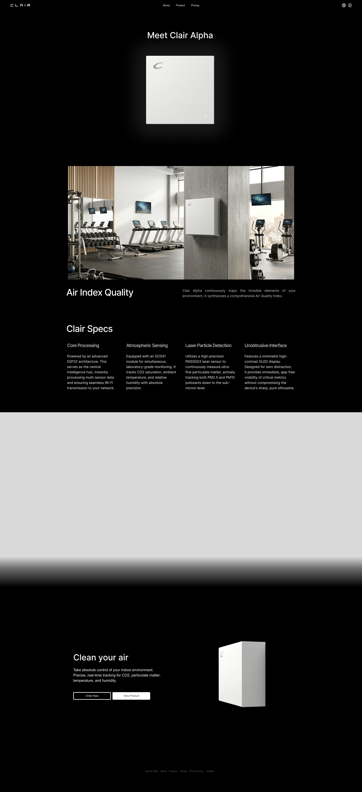

**Recomendación:**
Añadir un "Call to Action" (CTA) secundario en la sección Hero de la Landing Page que diga "Ver Precios y Planes", o incluir un pequeño badge debajo del título principal indicando el precio base del dispositivo (ej. "Desde S/ XXX"). Asimismo, se debe incluir una sección de Preguntas Frecuentes (FAQ) accesible desde el menú principal que responda directamente: "¿Necesito un técnico para instalarlo?" y "¿Hay costos de mantenimiento?".

---

**PROBLEMA #2:** El sistema muestra datos numéricos y colores, pero no ofrece recomendaciones accionables sobre qué hacer ante una alerta.

**Severidad:** 3
**Heurística violada:** Usability - Correspondencia entre el sistema y el mundo real.

**Problema:**
Los 6 participantes (100% de la muestra) coincidieron en la necesidad de recibir instrucciones claras junto con los datos. Expresiones como *"No solamente indicar que el aire está mal, sino explicar qué acciones podemos realizar para mejorarlo"* (VI-03) o *"Esperaría encontrar... alguna recomendación para solucionar el problema"* (VI-01) evidencian que un dashboard que solo muestra números y semáforos obliga al usuario a tener conocimientos técnicos previos. El sistema actual informa (ej. CO₂ alto) pero no asiste en la mitigación (ej. "Abrir ventanas por 10 minutos").

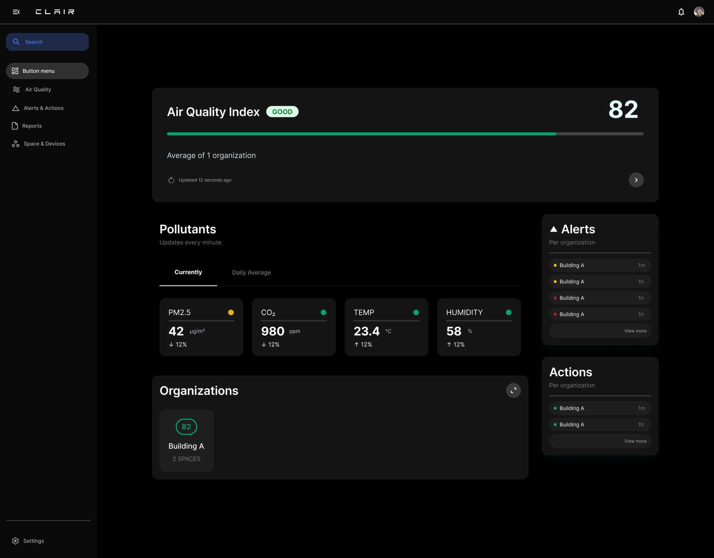

**Recomendación:**
Integrar un motor de recomendaciones simple en las tarjetas de métricas y en las notificaciones push. Cuando un valor supere el umbral, mostrar un texto contextual claro y accionable (ej. "Nivel de CO₂ elevado. Se recomienda ventilar el área abriendo ventanas"). Esto se alinea con el tono "Sereno y Formal" definido en las guías de estilo.

---

**PROBLEMA #3:** La confianza del usuario depende enteramente de la precisión del sensor, pero no se muestran certificaciones o información sobre la calibración.

**Severidad:** 2
**Heurística violada:** Usability - Ayuda y documentación.

**Problema:**
Cinco de los seis entrevistados (VI-01, VI-02, VI-03, VI-05 y VI-06) condicionaron explícitamente su recomendación y uso continuo a que las mediciones sean confiables. Sus dudas sobre "qué tan exactos son los sensores" no encuentran respuesta rápida en la Landing Page. Al no ser un dispositivo médico certificado, el usuario necesita entender cómo funciona el hardware (sensores SCD41 y PMS5003) para depositar su confianza en él.


**Recomendación:**
Destacar en la Landing Page un apartado de "Precisión y Calidad" que explique de forma sencilla los componentes del hardware (ej. "Equipado con sensores suizos de alta precisión"). Asimismo, dentro de la Web App, añadir un tooltip o ícono de información junto a los datos del dashboard que indique la fecha de la última calibración del dispositivo.

---

**PROBLEMA #4:** El indicador visual del estado del aire (semáforo) no cuenta con texto explicativo o leyendas accesibles en todas las vistas.

**Severidad:** 2
**Heurística violada:** Inclusive Design - Proporciona experiencias comparables.

**Problema:**
Aunque los usuarios del hogar (VI-04, VI-05) valoraron positivamente el uso de colores (verde/rojo) para interpretar el estado del aire de forma rápida, el usuario VI-05 acotó que *"los colores ayudan bastante, siempre que estén acompañados de explicaciones"*. Depender únicamente del color (especialmente en gráficos o en el dashboard de la app móvil) puede afectar a usuarios con daltonismo o baja visión, y deja espacio a la ambigüedad para usuarios noveles.

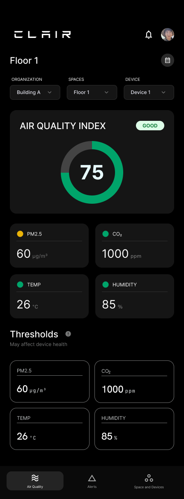

**Recomendación:**
Asegurar que todos los indicadores de color vayan acompañados de una etiqueta textual (ej. "Óptimo", "Moderado", "Crítico") y un ícono distintivo. Aplicar los atributos ARIA necesarios (`aria-label`) en las interfaces web para que los lectores de pantalla puedan interpretar el estado del aire sin depender del color.

---

**PROBLEMA #5:** La configuración de reglas personalizadas en la app móvil puede volverse confusa si se requieren múltiples pasos.

**Severidad:** 2
**Heurística violada:** Usability - Prevención de errores / Flexibilidad y eficiencia de uso.

**Problema:**
El usuario del hogar que desea crear alertas personalizadas (por ejemplo, avisar si el CO₂ supera los 1000 ppm) manifestó (VI-04) que necesitaba que el proceso tuviera *"pasos sencillos y no tener que buscar demasiadas opciones"*. Si el "Rules Builder" o la configuración de umbrales en la app móvil presenta menús anidados o formularios largos, los usuarios con baja alfabetización digital podrían abandonar la tarea o configurar alertas erróneas.

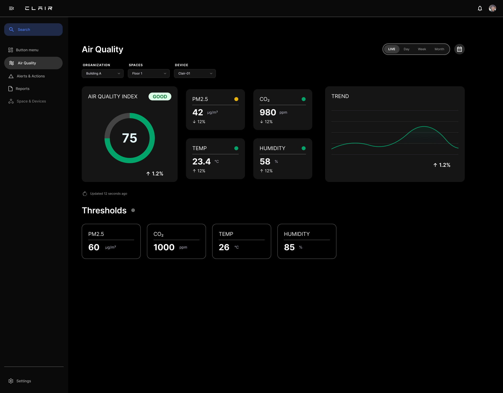

**Recomendación:**
Implementar una interfaz de configuración basada en plantillas o "presets" rápidos (ej. "Alerta estándar de CO₂", "Alerta para habitación de niños") para que el usuario solo tenga que elegir una opción y confirmar, reduciendo la carga cognitiva y previniendo errores de configuración.


## 6.4. Auditoría de Experiencias de Usuario

### 6.4.1. Auditoría realizada

#### 6.4.1.1. Información del grupo auditado.

| Campo | Detalle                                                                                                                                                 |
| :--- |:--------------------------------------------------------------------------------------------------------------------------------------------------------|
| **Nombre de la Startup** | HuariApp                                                                                                                                                |
| **Nombre del Producto** | PuntoSabor                                                                                                                                              |
| **Integrante 1** | Contreras Rojas, Cesar Jair (u20241d995)                                                                                                                |
| **Integrante 2** | Delgado Carrasco, Schneider (u202321843)                                                                                                                |
| **Integrante 3** | Lopez Goitia, Carlos Alberto (u202312700)                                                                                                               |
| **Integrante 4** | Montalván Palomino, Bruno Rodolfo (u202411282)                                                                                                          |
| **Integrante 5** | Razuri Alvarez, Matias Francesco (u202410772)                                                                                                           |
| **Repositorio del Informe** | https://github.com/HuariApp/puntosabor-report/tree/develop                                                                                              |
| **Repositorio Landing Page** | https://github.com/HuariApp/PuntoSabor-Landing                                                                                                          |
| **Repositorio Frontend Web** | https://github.com/HuariApp/PuntoSabor-Front                                                                                                            |
| **Repositorio Backend/API** | https://github.com/HuariApp/PuntoSabor-Backend                                                                                                                                                       |
| **URL Landing Page** | https://huariapp.github.io/PuntoSabor-Landing/                                                                                                          |
| **URL Frontend Web** | https://punto-sabor-front.vercel.app                                                                                                                    |
| **URL Backend/Swagger** | https://huariquehub-backend.up.railway.app/swagger                                                                                                      |

#### 6.4.1.2. Cronograma de auditoría realizada.

| Fecha          | Hora Inicio | Hora Fin   | Actividad Realizada | Duración    | Auditores Participantes |
|:---------------|:------------|:-----------| :--- |:------------|:------------------------|
| `[10/11/2026]` | `[12:52M]`  | `[14:52M]` | **Revisión de Landing Page:** Análisis de usabilidad, propuesta de valor, claridad en precios y formulario de contacto. | `[120] min` | `[Luis Huaco]`          |
| `[10/11/2026]` | `[13:29]`   | `[15:24]`  | **Prueba de User Flows (Frontend):** Navegación por la Web App (Búsqueda, mapa, reseñas, login) y evaluación de heurísticas de Nielsen. | `[120] min` | `[Mateo]`               |
| `[10/11/2026]` | `[16:00]`   | `[18:00]`  | **Prueba de Flujos de Dueño (Frontend):** Simulación de registro de huarique, selección de planes y gestión de perfil. | `[120] min` | `[Nicolas]`             |
| `[10/11/2026]` | `[17:00]`   | `[19:00]`  | **Revisión de Acuerdo de Servicio (SaaS):** Análisis de claridad legal, políticas de cancelación y transparencia de precios. | `[120] min` | `[Anderson]`            |
| `[10/11/2026]` | `[20:00]`   | `[23:00]`  | **Consolidación de hallazgos:** Redacción del documento de auditoría, asignación de severidades y propuestas de mitigación (Anexo D). | `[180] min` | `[Iker]`                |

---
**Nota:** Para el punto **6.4.2.4. Resumen de modificaciones para subsanar hallazgos**, puedes usar los 5 problemas que te redacté en el mensaje anterior (Prevención de errores en reseñas, botón "Cómo llegar" en el mapa, guardado automático del formulario de huarique, botón de cambio de rol y transparencia en la política de cancelación) y simplemente redactar una breve conclusión de cómo esas mejoras impactarían positivamente en el producto de HuariApp.


#### 6.4.1.3. Contenido de auditoría realizada.

#### Anexo D. Formato para Evaluación de User Experience según Heurísticas

**UX Heuristics & Principles Evaluation**
**Usability – Inclusive Design – Information Architecture**

| |                                                                                                                                                        |
| :--- |:-------------------------------------------------------------------------------------------------------------------------------------------------------|
| **CARRERA** | Ingeniería de Software                                                                                                                                 |
| **CURSO** | Diseño de Experimentos de Ingeniería de Software                                                                                                       |
| **NRC** | `[9112]`                                                                                                                                               |
| **PROFESORES** | Cenas Vasquez, Lennin Percy / Flores Morocco, Juan Antonio / Noriega Melendez, Julio Manuel / Sanchez Ponce, Alex humberto / Yesn Paiba, Juan Fernando |
| **AUDITOR** | `[Banawire]`                                                                                                                                           |
| **CLIENTE(S)** | HuariApp / PuntoSabor (Equipo auditado)                                                                                                                |

**SITE o APP A EVALUAR:**
PuntoSabor (Landing Page, Web Application y Mobile Application)

**TAREAS A EVALUAR:**

El alcance de esta evaluación incluye la revisión de la usabilidad de las siguientes tareas (basadas en los User Flows del equipo auditado):

1. Iniciar sesión y registrarse como Explorador.
2. Búsqueda y filtrado de huariques por categoría y precio (Explore).
3. Visualización de huariques en el mapa e interacción con los marcadores.
4. Publicación de una reseña y calificación en un huarique.
5. Registro de un nuevo huarique (flujo para Dueños).
6. Visualización y selección de planes de membresía (Basic, Premium, Exclusive).
7. Guardar un huarique en la lista de favoritos.
8. Enviar un mensaje a través del formulario de contacto (Landing Page).

No están incluidas en esta versión de la evaluación las siguientes tareas:

1. Flujo de pago real de membresía con pasarela externa (Stripe/Niubiz).
2. Recuperación de contraseña vía correo electrónico.
3. Módulo de notificaciones push en tiempo real (debido a que requiere configuración del dispositivo).
4. Panel de administración avanzado o estadísticas para el Dueño del huarique.

**ESCALA DE SEVERIDAD:**

Los errores serán puntuados tomando en cuenta la siguiente escala de severidad:

| Nivel | Descripción |
| :---: | :--- |
| **1** | **Problema superficial:** puede ser fácilmente superado por el usuario u ocurre con muy poca frecuencia. No necesita ser arreglado a no ser que exista disponibilidad de tiempo. |
| **2** | **Problema menor:** puede ocurrir un poco más frecuentemente o es un poco más difícil de superar para el usuario. Se le debería asignar una prioridad baja resolverlo de cara al siguiente release. |
| **3** | **Problema mayor:** ocurre frecuentemente o los usuarios no son capaces de resolverlos. Es importante que sean corregidos y se les debe asignar una prioridad alta. |
| **4** | **Problema muy grave:** un error de gran impacto que impide al usuario continuar con el uso de la herramienta. Es imperativo que sea corregido antes del lanzamiento. |

**TABLA RESUMEN:**

| # | Problema | Escala de severidad | Heurística/Principio violada(o) |
| :---: | :--- | :---: | :--- |
| 1 | Falta de feedback visual inmediato al intentar publicar una reseña duplicada o con errores de validación. | 3 | Usability: Prevención de errores / Visibilidad del estado del sistema |
| 2 | El popup del mapa (Explore) muestra información básica, pero no incluye un botón de acción rápida para "Cómo llegar" (integración con Google Maps/Waze). | 3 | Information Architecture: Is it useful? / Usability: Flexibilidad y eficiencia de uso |
| 3 | El formulario de registro de huarique para los dueños presenta múltiples campos obligatorios sin guardado automático, lo que puede causar pérdida de datos. | 3 | Usability: Libertad y control del usuario |
| 4 | La transición entre el rol de "Explorador" y "Dueño" dentro de la misma cuenta no es evidente en la navegación principal. | 2 | Usability: Consistencia y estándares |
| 5 | En la Landing Page, los precios de las membresías (Básico, Premium, Exclusivo) se muestran, pero los detalles sobre cómo se procesa el pago o si hay contratos de permanencia no son explícitos. | 2 | Information Architecture: Is it findable? |

---

**DESCRIPCIÓN DE PROBLEMAS:**

**PROBLEMA #1:** Falta de feedback visual inmediato al intentar publicar una reseña duplicada o con errores de validación.

**Severidad:** 3
**Heurística violada:** Usability - Prevención de errores / Visibilidad del estado del sistema.

**Problema:**
En la User Story US07 ("Publicar reseñas"), el sistema establece que un usuario no puede publicar más de una reseña para el mismo huarique. Sin embargo, en la interfaz evaluada, si el usuario ya reseñó el local o deja campos vacíos, el sistema no muestra un mensaje de error claro o un estado visual que indique por qué la acción está bloqueada. El botón de "Publicar" simplemente no responde o recarga la página, lo que genera confusión y frustración en el explorador gastronómico.

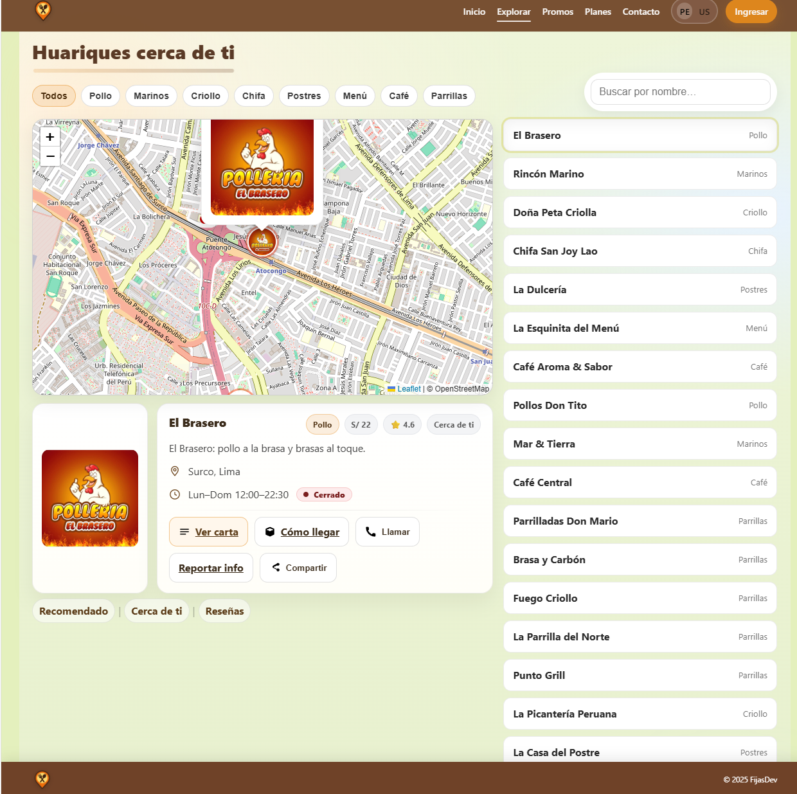

**Recomendación:**
Implementar validaciones en línea (inline validation). Si el usuario ya dejó una reseña, el formulario debe ocultarse y reemplazarse por un mensaje como "Ya has calificado este huarique". Si faltan campos, el botón debe deshabilitarse o mostrar un texto en rojo indicando exactamente qué campo falta (ej. "Por favor, escribe un comentario antes de enviar").

---

**PROBLEMA #2:** El popup del mapa (Explore) muestra información básica, pero no incluye un botón de acción rápida para "Cómo llegar".

**Severidad:** 3
**Heurística violada:** Information Architecture - Is it useful? / Usability - Flexibilidad y eficiencia de uso.

**Problema:**
En el flujo de "Visualizar huariques en mapa" (US02), al hacer clic en el marcador de un huarique, aparece un popup flotante con el nombre, dirección y calificación. Sin embargo, para un explorador cuya principal motivación es visitar el lugar (según el User Persona de Carla Dípes), el flujo se interrumpe, ya que debe copiar la dirección manualmente y abrir otra aplicación. La falta de un botón directo que abra la ruta en Google Maps o Waze añade fricción al "happy path" del usuario.

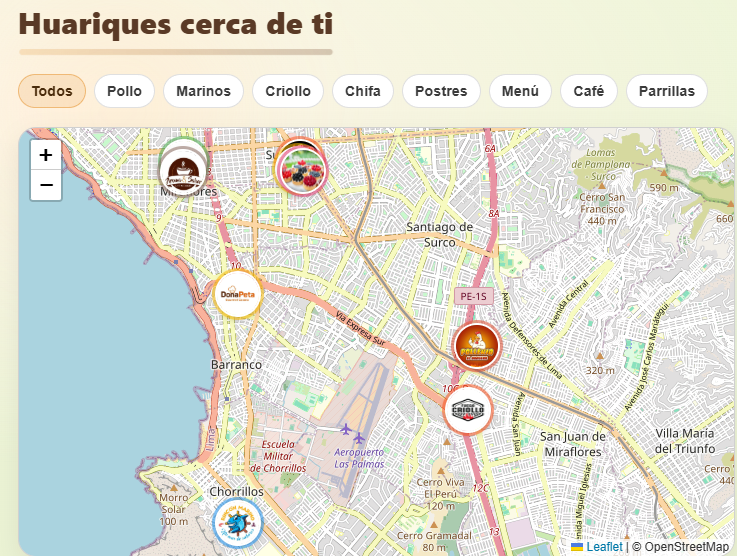

**Recomendación:**
Agregar un botón principal o un ícono de "Ruta" dentro del popup del marcador. Al hacer clic, debe abrir una nueva pestaña o la app nativa de mapas con la latitud y longitud del huarique ya configuradas. Esto reduce la carga cognitiva y agiliza el proceso de visita.

---

**PROBLEMA #3:** El formulario de registro de huarique para los dueños presenta múltiples campos obligatorios sin guardado automático.

**Severidad:** 3
**Heurística violada:** Usability - Libertad y control del usuario.

**Problema:**
El User Persona del dueño (Don Luis) representa a un emprendedor con restricciones tecnológicas. En el flujo de "Registrar un nuevo huarique" (US04), el formulario solicita nombre, categoría, dirección, distrito, rango de precios, horarios, descripción y fotos. Si el dueño se distrae o su conexión a internet falla a mitad del proceso, al regresar perderá todo el progreso. No hay un mecanismo de "borrador" ni una forma fácil de regresar sin salir del formulario por completo.

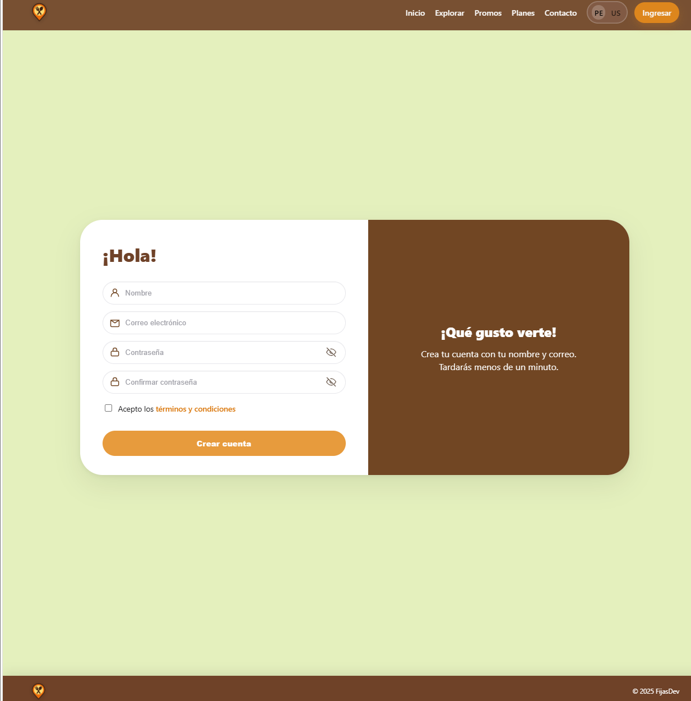

**Recomendación:**
Dividir el formulario en un proceso "Paso a Paso" (Wizard) de máximo 3 pasos (Información Básica, Horarios/Ubicación, Fotos). Además, implementar un guardado automático temporal en el `localStorage` o en la base de datos, de modo que si el usuario sale o recarga, pueda retomar donde lo dejó.

---

**PROBLEMA #4:** La transición entre el rol de "Explorador" y "Dueño" dentro de la misma cuenta no es evidente.

**Severidad:** 2
**Heurística violada:** Usability - Consistencia y estándares.

**Problema:**
El backend de PuntoSabor permite que un mismo usuario (a través de la entidad `User` con el campo `Role`) pueda ser explorador o dueño. Sin embargo, en la interfaz web y móvil, la navegación está diseñada como si el usuario fuera uno u otro. Si un usuario que exploró huariques decide registrar su propio negocio, no hay un botón claro en el menú de perfil que diga "Convertirme en Dueño" o "Panel de Propietario", lo que obliga al usuario a buscar opciones ocultas o registrarse de nuevo.

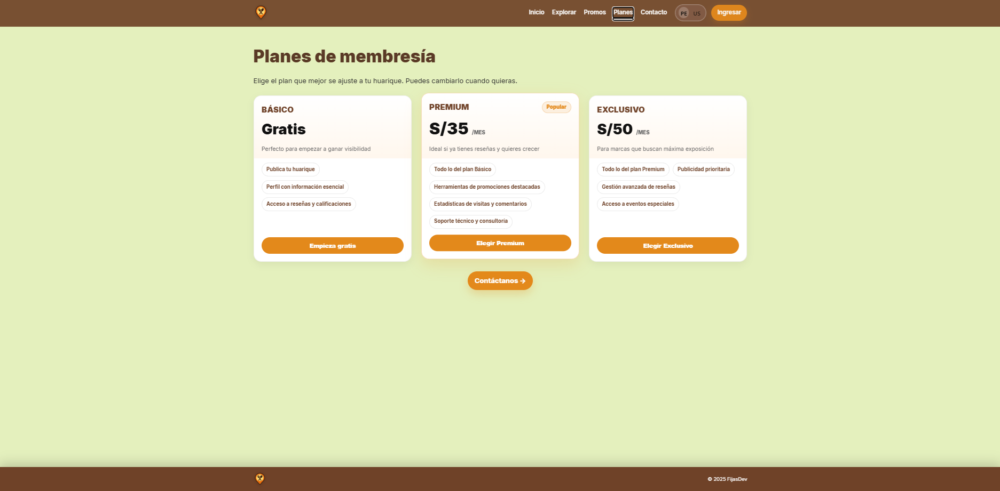

**Recomendación:**
Añadir un "Toggle" (interruptor) o un botón en el menú de perfil (como "Modo Dueño") que permita al usuario alternar la vista de la aplicación. Si no tiene un huarique registrado, este botón debe llevarlo al flujo de registro (US04). Si ya lo tiene, debe llevarlo a su panel de gestión.

---

**PROBLEMA #5:** En la Landing Page, los precios de las membresías se muestran, pero la letra pequeña sobre la cancelación o el procesamiento de pagos no es explícita.

**Severidad:** 2
**Heurística violada:** Information Architecture - Is it findable?

**Problema:**
El Acuerdo de Servicio (sección 5.2.4) detalla claramente que los dueños pueden cancelar su membresía en cualquier momento y que no hay reembolsos, pero en la sección de precios de la Landing Page solo se muestran los montos ($35 y $50) y los beneficios. Para generar confianza (especialmente en microempresarios que rechazan comisiones abusivas), la información sobre la facilidad para cancelar o la ausencia de contratos forzosos debe estar visible antes de hacer clic en "Empezar".

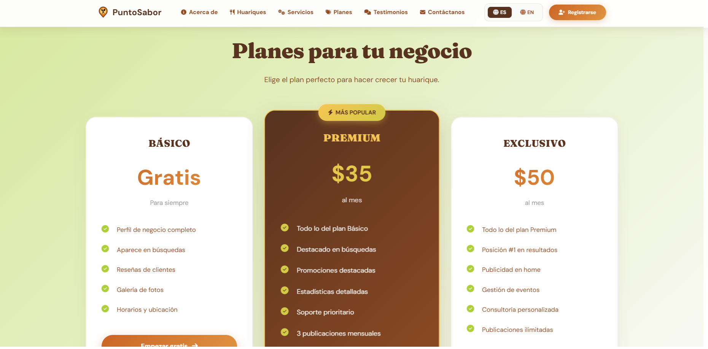

**Recomendación:**
Añadir un texto corto debajo de los botones de pago de los planes que diga: "Cancela en cualquier momento. Sin contratos forzosos". También se puede agregar un enlace directo al apartado de "Política de Cancelación" del Acuerdo de Servicio.


### 6.4.2. Auditoría recibida.

Esta sección registra la evaluación de experiencia de usuario que el equipo HuariApp aplicó sobre los productos de Clair. La auditoría siguió el formato del Anexo D (UX Heuristics & Principles Evaluation) y revisó la landing page, la aplicación web y la aplicación móvil desde tres frentes: heurísticas de usabilidad, principios de inclusive design y facetas de arquitectura de información. Bananawire actuó como cliente de la sesión: preparó los entornos, entregó las credenciales de prueba y recibió el informe de hallazgos.

#### 6.4.2.1. Información del grupo auditor.

| Campo | Detalle |
|---|---|
| Equipo auditor | HuariApp |
| Producto del equipo auditor | PuntoSabor, plataforma móvil que conecta a comensales con huariques de cocina tradicional |
| Curso | 1ASI0732 Diseño de Experimentos de Ingeniería de Software |
| NRC | 9112 |
| Docente | Lennin Percy Cenas Vasquez |
| Repositorio del informe | https://github.com/HuariApp/puntosabor-report |
| Equipo auditado (cliente) | Bananawire, producto Clair |

**Integrantes del equipo auditor**

| Código | Apellidos y Nombres |
|---|---|
| u20241d995 | Contreras Rojas, Cesar Jair |
| u202321843 | Delgado Carrasco, Schneider |
| u202312700 | Lopez Goitia, Carlos Alberto |
| u202411282 | Montalván Palomino, Bruno Rodolfo |
| u202410772 | Razuri Alvarez, Matias Francesco |

#### 6.4.2.2. Cronograma de auditoría recibida.

La auditoría se organizó en cuatro momentos. Primero, ambos equipos acordaron el alcance y las tareas que se evaluarían. Después, HuariApp ejecutó la sesión sobre los productos desplegados, entregó el informe y, por último, Bananawire revisó cada hallazgo con el equipo auditor para aclarar dudas antes de planificar las correcciones.

| Fecha | Actividad | Productos | Modalidad | Responsable |
|---|---|---|---|---|
| 03/11/2026 | Coordinación del alcance, tareas a evaluar y entrega de credenciales de prueba | Landing page, aplicación web y aplicación móvil | Virtual | Bananawire y HuariApp |
| 04/11/2026 | Sesión de evaluación de la landing page y de la aplicación web | Landing page y aplicación web | Virtual | HuariApp |
| 05/11/2026 | Sesión de evaluación de la aplicación móvil instalada mediante Firebase App Distribution | Aplicación móvil Android | Presencial | HuariApp |
| 07/11/2026 | Entrega del informe de evaluación según el formato del Anexo D | Todos | Virtual | HuariApp |
| 09/11/2026 | Revisión conjunta de hallazgos y priorización de correcciones | Todos | Virtual | Bananawire y HuariApp |

#### 6.4.2.3. Contenido de auditoría recibida.

**SITE o APP A EVALUAR:**

Clair: landing page, aplicación web (Angular) y aplicación móvil (Flutter).

**TAREAS A EVALUAR:**

El alcance de esta evaluación incluye la revisión de la usabilidad de las siguientes tareas:

1. Consulta de la propuesta de valor y comparación de planes en la landing page.
2. Registro de un usuario nuevo e inicio de sesión.
3. Creación de una organización y de un espacio.
4. Reclamo de un dispositivo mediante token y asignación a un espacio.
5. Configuración de un umbral de CO₂ o PM2.5 para un dispositivo.
6. Consulta de alertas activas e interpretación de su gravedad.
7. Envío de comandos de standby, activación y reinicio a un dispositivo.
8. Consulta del dashboard y del gráfico de tendencias de un sensor en la aplicación móvil.
9. Revisión de la lista de notificaciones en la aplicación móvil.

No están incluidas en esta versión de la evaluación las siguientes tareas:

1. Pago de la suscripción Premium mediante Stripe.
2. Configuración de la red Wi-Fi del dispositivo embebido.
3. Eliminación de organizaciones, espacios y dispositivos.
4. Operación del edge service y sus endpoints técnicos.

**ESCALA DE SEVERIDAD:**

Los errores serán puntuados tomando en cuenta la siguiente escala de severidad:

| Nivel | Descripción |
|---|---|
| 1 | Problema superficial: puede ser fácilmente superado por el usuario u ocurre con muy poca frecuencia. No necesita ser arreglado a no ser que exista disponibilidad de tiempo. |
| 2 | Problema menor: puede ocurrir un poco más frecuentemente o es un poco más difícil de superar para el usuario. Se le debería asignar una prioridad baja resolverlo de cara al siguiente release. |
| 3 | Problema mayor: ocurre frecuentemente o los usuarios no son capaces de resolverlo. Es importante que sea corregido y se le debe asignar una prioridad alta. |
| 4 | Problema muy grave: un error de gran impacto que impide al usuario continuar con el uso de la herramienta. Es imperativo que sea corregido antes del lanzamiento. |

**TABLA RESUMEN:**

| # | Problema | Escala de severidad | Heurística/Principio violada(o) |
|---|---|---|---|
| 1 | Un dispositivo desconectado aparece con el indicador de conectado en la aplicación web | 3 | Usability: Visibilidad del estado del sistema |
| 2 | Las alertas muestran el valor medido y la gravedad, pero no explican qué significa ni qué acción tomar | 3 | Usability: Coincidencia entre el sistema y el mundo real |
| 3 | El comando de reinicio se envía al dispositivo sin pedir confirmación | 3 | Usability: Prevención de errores |
| 4 | El estado de la calidad del aire se comunica solo mediante color | 3 | Inclusive Design: Proporciona experiencias comparables |
| 5 | Reclamar un dispositivo con el token vacío devuelve un error genérico | 2 | Usability: Ayudar a los usuarios a reconocer, diagnosticar y recuperarse de errores |
| 6 | La configuración de umbrales no ofrece valores de referencia | 2 | Usability: Ayuda y documentación |
| 7 | Se usan términos distintos para la misma entidad entre la landing page, la web y la app | 2 | Usability: Consistencia y estándares |
| 8 | Los comandos del dispositivo se representan solo con íconos | 2 | Usability: Reconocimiento antes que recuerdo |
| 9 | El primer ingreso a la app móvil sin dispositivos muestra un dashboard vacío sin indicar el siguiente paso | 2 | Information Architecture: Is it usable? |
| 10 | La página de precios no aclara si el costo del dispositivo está incluido en el plan | 2 | Information Architecture: Is it findable? |
| 11 | El gráfico de tendencias de la app móvil no muestra las unidades de cada métrica | 1 | Inclusive Design: Prioriza el contenido |

**DESCRIPCIÓN DE PROBLEMAS:**

**PROBLEMA #1: Un dispositivo desconectado aparece con el indicador de conectado en la aplicación web**

Severidad: 3

Heurística violada: Usability - Visibilidad del estado del sistema

Problema:
En la vista de dispositivos de un espacio, el auditor apagó un sensor de prueba y esperó a que la plataforma registrara el cambio. El estado textual pasó a `DISCONNECTED`, pero el indicador de color se mantuvo como si el dispositivo siguiera conectado. Un administrador que revisa la vista de forma rápida puede asumir que el monitoreo continúa activo cuando el sensor ya no envía lecturas.

Recomendación:
Corregir la regla que traduce el estado de conectividad al color del indicador, de modo que compare el valor exacto del estado y no una coincidencia parcial del texto. Acompañar el color con la etiqueta del estado.

**PROBLEMA #2: Las alertas muestran el valor medido y la gravedad, pero no explican qué significa ni qué acción tomar**

Severidad: 3

Heurística violada: Usability - Coincidencia entre el sistema y el mundo real

Problema:
Una alerta de CO₂ presenta la métrica, el valor en ppm y el nivel de gravedad. Los auditores, sin formación técnica en calidad del aire, no pudieron explicar si 1 400 ppm representaba un riesgo ni qué debían hacer. La alerta cumple su función técnica, pero deja al usuario sin una decisión clara, que es justamente la necesidad que Clair declara atender.

Recomendación:
Añadir a cada alerta una explicación breve del riesgo y una acción concreta según la métrica y la gravedad, por ejemplo ventilar el ambiente ante CO₂ elevado o cerrar ventanas ante PM2.5 exterior elevado.

**PROBLEMA #3: El comando de reinicio se envía al dispositivo sin pedir confirmación**

Severidad: 3

Heurística violada: Usability - Prevención de errores

Problema:
Los comandos de standby, activación y reinicio se encuentran juntos en la vista del dispositivo. Al intentar activar un sensor, un auditor seleccionó el reinicio por error y el comando se envió de inmediato. Durante el reinicio el dispositivo deja de reportar telemetría, por lo que un error de este tipo interrumpe el monitoreo sin que el usuario lo haya decidido.

Recomendación:
Solicitar confirmación antes de enviar el reinicio, indicando que el dispositivo dejará de reportar durante unos segundos, y separar visualmente este comando de los comandos no disruptivos.

**PROBLEMA #4: El estado de la calidad del aire se comunica solo mediante color**

Severidad: 3

Heurística violada: Inclusive Design - Proporciona experiencias comparables

Problema:
En las tarjetas de sensor de la web y en el dashboard de la app móvil, la diferencia entre un estado bueno, moderado y crítico depende del color verde, amarillo o rojo. Una persona con daltonismo, o un usuario que revisa el celular bajo luz solar directa, no recibe la misma información que el resto.

Recomendación:
Acompañar el color con una etiqueta textual del estado (Bueno, Moderado, Crítico) y con un ícono diferenciado por nivel.

**PROBLEMA #5: Reclamar un dispositivo con el token vacío devuelve un error genérico**

Severidad: 2

Heurística violada: Usability - Ayudar a los usuarios a reconocer, diagnosticar y recuperarse de errores

Problema:
Al confirmar el reclamo de un dispositivo sin ingresar el token, la aplicación web mostró un mensaje de error inesperado en lugar de indicar que el campo es obligatorio. El usuario no sabe si el problema está en el token, en el dispositivo o en la plataforma.

Recomendación:
Validar el token antes de enviar la solicitud y mostrar un mensaje que indique el campo faltante y dónde encontrar el token del dispositivo.

**PROBLEMA #6: La configuración de umbrales no ofrece valores de referencia**

Severidad: 2

Heurística violada: Usability - Ayuda y documentación

Problema:
Para crear un umbral de CO₂ o PM2.5, el usuario debe escribir el valor límite sin ninguna orientación. Los auditores no sabían qué valor era razonable y probaron cifras al azar. Un umbral mal configurado genera alertas innecesarias o, peor, no genera alertas cuando el aire sí es dañino.

Recomendación:
Mostrar un valor de referencia sugerido para cada métrica y una explicación breve de su origen, permitiendo al usuario aceptarlo o ajustarlo.

**PROBLEMA #7: Se usan términos distintos para la misma entidad entre la landing page, la web y la app**

Severidad: 2

Heurística violada: Usability - Consistencia y estándares

Problema:
La entidad que agrupa los sensores aparece como "Organización" en la aplicación web, como "Local" en otros textos y la subdivisión aparece como "Espacio" o "Zona" según la pantalla. Los auditores dudaron si se trataba de entidades diferentes al pasar de un producto a otro.

Recomendación:
Definir un solo término por entidad, alineado con el Ubiquitous Language del informe, y aplicarlo en los tres productos.

**PROBLEMA #8: Los comandos del dispositivo se representan solo con íconos**

Severidad: 2

Heurística violada: Usability - Reconocimiento antes que recuerdo

Problema:
Los comandos de standby, activación y reinicio se muestran como íconos sin texto. Los auditores tuvieron que pasar el cursor sobre cada uno para descubrir su función, y en la versión móvil no existe ese recurso. Además, los lectores de pantalla no anuncian un nombre útil para estos controles.

Recomendación:
Añadir una etiqueta visible a cada comando y un nombre accesible para tecnologías de apoyo.

**PROBLEMA #9: El primer ingreso a la app móvil sin dispositivos muestra un dashboard vacío sin indicar el siguiente paso**

Severidad: 2

Heurística violada: Information Architecture - Is it usable?

Problema:
Un usuario recién registrado que ingresa a la app móvil encuentra el dashboard sin datos y sin un mensaje que explique por qué. No queda claro si la app falló o si falta vincular un dispositivo.

Recomendación:
Mostrar un estado vacío que explique que aún no hay dispositivos vinculados y que guíe al usuario hacia la creación de su espacio y el reclamo de su primer dispositivo.

**PROBLEMA #10: La página de precios no aclara si el costo del dispositivo está incluido en el plan**

Severidad: 2

Heurística violada: Information Architecture - Is it findable?

Problema:
La landing page presenta el precio de los planes y el precio del dispositivo Clair Alpha, pero no indica si la suscripción incluye el hardware o si se trata de pagos separados. Los auditores no pudieron estimar el costo total del primer mes.

Recomendación:
Detallar qué incluye cada plan y presentar el costo inicial total (dispositivo y primer mes de suscripción) junto a cada opción.

**PROBLEMA #11: El gráfico de tendencias de la app móvil no muestra las unidades de cada métrica**

Severidad: 1

Heurística violada: Inclusive Design - Prioriza el contenido

Problema:
El gráfico de tendencias presenta la curva de cada métrica sin indicar si los valores están en ppm, µg/m³, °C o porcentaje. El usuario lo deduce por el nombre de la métrica, pero la lectura se vuelve más lenta cuando compara varias.

Recomendación:
Mostrar la unidad junto al nombre de la métrica y en el eje de valores del gráfico.

#### 6.4.2.4. Resumen de modificaciones para subsanar hallazgos.

El equipo revisó los once hallazgos y los clasificó según su origen. Los problemas #1, #3, #5 y #8 son defectos o descuidos de implementación en `clair-ui`, y se corrigen sin cambiar el comportamiento esperado de las User Stories del Capítulo III. El problema #1 coincide con el defecto DEF-02 que la suite de pruebas unitarias ya había detectado en la sección 6.1.3; la auditoría confirmó que el defecto sí afecta al usuario final. Los problemas #2, #4, #6 y #9 tocan la forma en que Clair comunica el estado del aire, que es el supuesto central de las hipótesis Lean UX del Capítulo I. Por eso no se corrigen solo como ajustes de interfaz: se incorporan al To-Be Product Backlog de la sección 8.3 para medir su efecto mediante experimentos. Los problemas #7, #10 y #11 son ajustes de contenido de baja complejidad.

| # | Hallazgo | Modificación | Producto | Severidad | Tratamiento |
|---|---|---|---|---|---|
| 1 | Dispositivo desconectado con indicador de conectado | Comparar el valor exacto del estado de conectividad y acompañar el color con la etiqueta del estado | Aplicación web (`clair-ui`) | 3 | Corrección del defecto DEF-02 |
| 2 | Alertas sin explicación ni acción sugerida | Asociar a cada alerta una recomendación según la métrica y la gravedad | Web services, aplicación web y aplicación móvil | 3 | To-Be User Stories (sección 8.3.1) |
| 3 | Reinicio sin confirmación | Solicitar confirmación antes de enviar el comando de reinicio y separarlo de los comandos no disruptivos | Aplicación web (`clair-ui`) | 3 | Corrección de interfaz |
| 4 | Estado comunicado solo por color | Añadir etiqueta textual e ícono por nivel de calidad del aire | Aplicación web y aplicación móvil | 3 | To-Be User Stories (sección 8.3.1) |
| 5 | Error genérico con token vacío | Validar el token antes de enviar la solicitud y mostrar un mensaje específico | Aplicación web (`clair-ui`) | 2 | Corrección del defecto DEF-01 |
| 6 | Umbrales sin valores de referencia | Sugerir un valor de referencia por métrica al crear un umbral | Aplicación web | 2 | To-Be User Stories (sección 8.3.1) |
| 7 | Términos distintos para la misma entidad | Unificar los términos con el Ubiquitous Language de la sección 2.4 | Landing page, aplicación web y aplicación móvil | 2 | Ajuste de contenido |
| 8 | Comandos representados solo con íconos | Añadir etiqueta visible y nombre accesible a cada comando | Aplicación web y aplicación móvil | 2 | Corrección de interfaz |
| 9 | Dashboard vacío en el primer ingreso | Mostrar un estado vacío que guíe hacia la vinculación del primer dispositivo | Aplicación móvil | 2 | To-Be User Stories (sección 8.3.1) |
| 10 | Precios sin detalle de lo incluido | Detallar qué incluye cada plan y el costo inicial total | Landing page | 2 | To-Be User Stories (sección 8.3.1) |
| 11 | Gráfico sin unidades | Mostrar la unidad junto a la métrica y en el eje de valores | Aplicación móvil | 1 | Ajuste de contenido |

Los hallazgos con severidad 3 tienen prioridad en el siguiente sprint. Las correcciones directas se integran mediante ramas `feature/*` hacia `develop`, con el mismo Pull Request y las mismas revisiones descritas en la sección 6.2.2. Los hallazgos que pasan al To-Be Product Backlog se validan con las métricas definidas en el Capítulo VIII, de modo que el equipo pueda comprobar si la modificación mejora la comprensión del usuario y no solo si la interfaz cambió.
